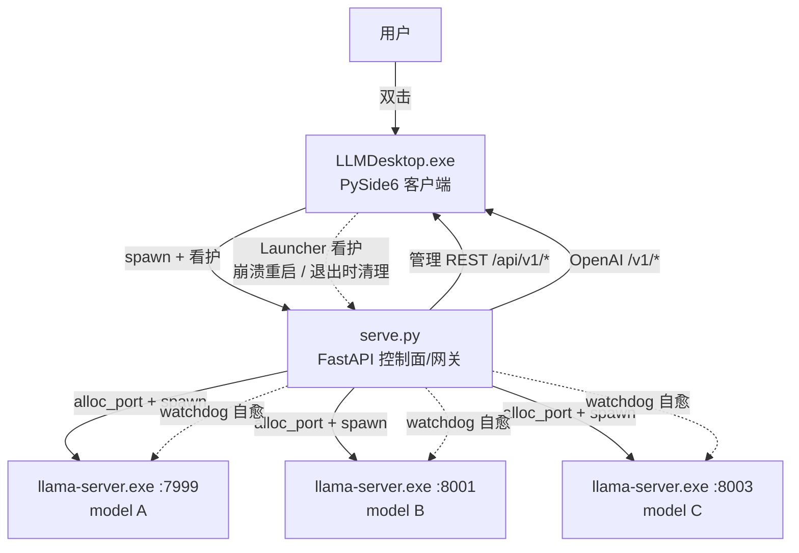
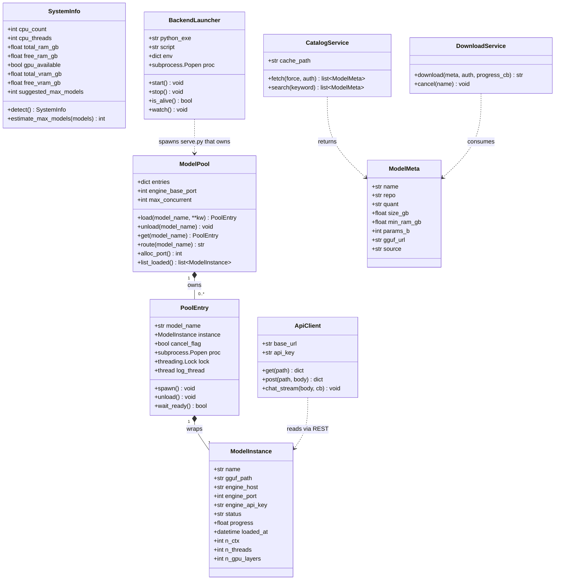
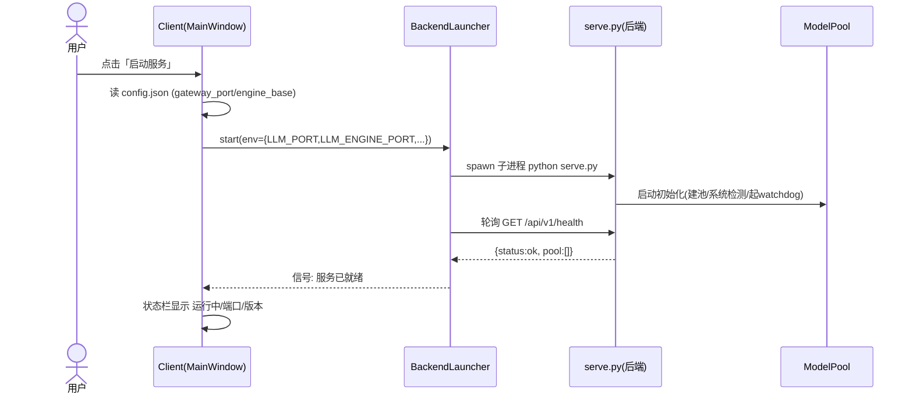
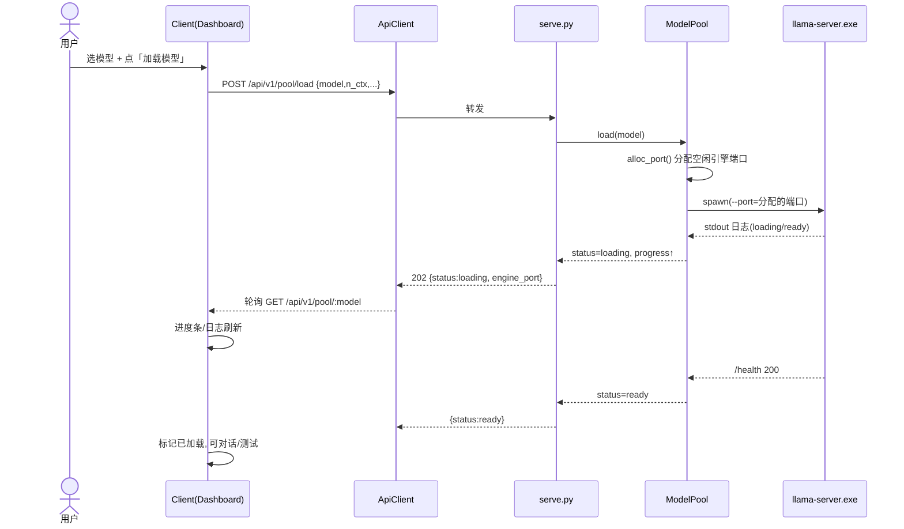
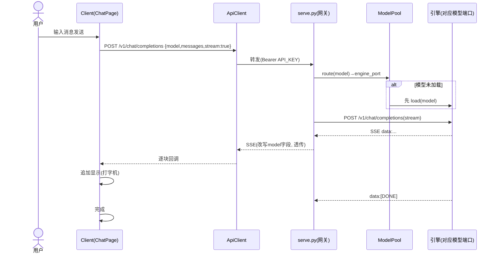
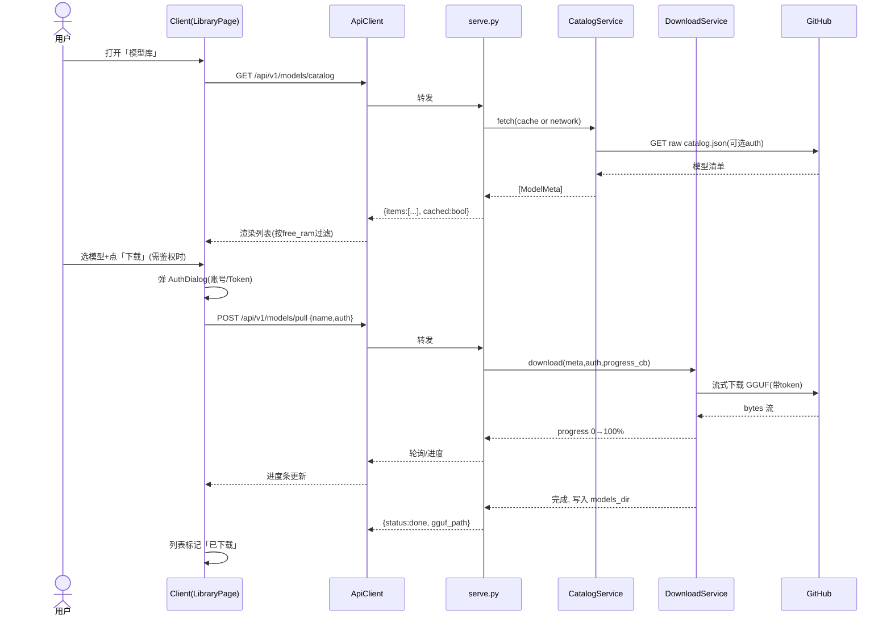
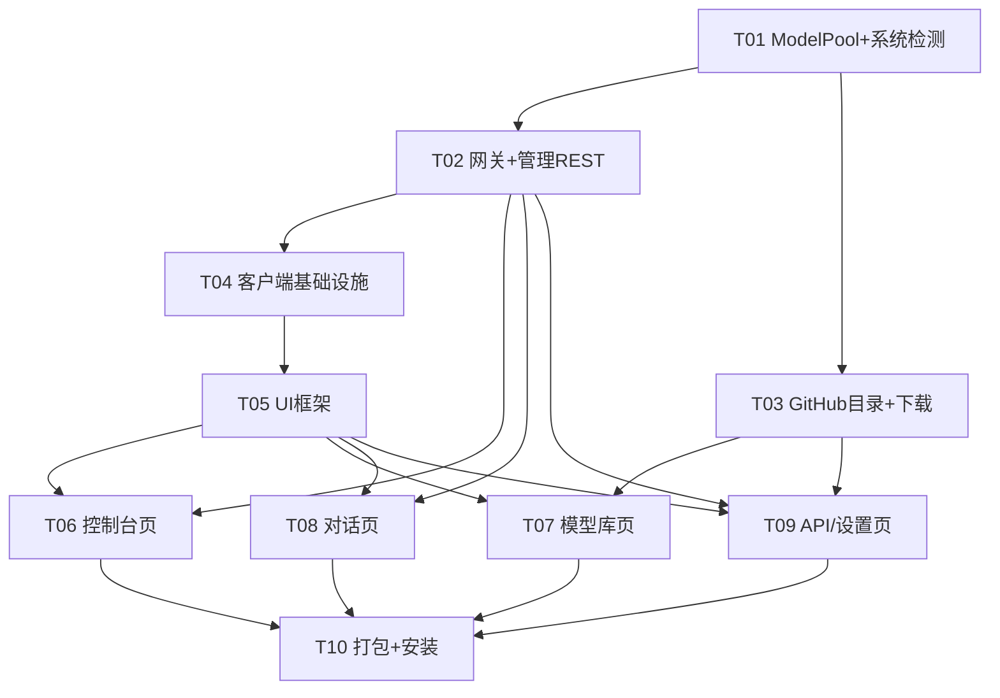

# 本地大模型服务 C/S 桌面产品 — 系统设计与任务分解

> 架构师：高见远（Gao / Bob）· 角色：Architect
> 版本：v1.0 · 日期：基于现有 `E:/llm-service/serve.py` 增量设计
> 读者：工程师（实现方）、产品经理（对齐）

---

## 0. 文档说明与范围

### 0.1 现状（已有代码）
- 后端 `serve.py`：FastAPI，作为「控制面 + OpenAI 兼容网关」，单例 `engine_proc` 当前只服务**一个**模型（`engine_model` 全局变量）。
- 已具备：`switch_model`（热切换）、`trim_messages`（上下文裁剪）、`_normalize`（工具调用归一化）、`watchdog`（引擎崩溃自愈）、SSE 流式透传。
- 配置来自环境变量：`LLM_HOST / LLM_PORT(8000) / LLM_ENGINE_PORT(7999) / LLM_N_CTX / LLM_N_THREADS / LLM_API_KEY / LLM_DEFAULT_MODEL / LLM_MODELS_DIR`。
- `MODEL_REGISTRY` 写死 3 个模型名 → GGUF 文件名映射；`MODELS_DIR` 默认 `E:\llama-serve\models`。
- 引擎：`E:\llm-service\engine\llama-server.exe`（llama.cpp 原生服务端）。

### 0.2 本次目标
在**不推翻现有网关能力**的前提下，补全：
1. **多模型并发引擎池（ModelPool）**，替代单例 `engine_proc`；
2. **服务端管理 REST 接口**（系统检测 / 端口扫描 / GitHub 目录 / 下拉下载 / Key 生成 / 加载卸载 / 并发上限）；
3. **PySide6 桌面客户端**（启动停止服务、加载卸载模型、对话、模型库、API 信息、设置、打包安装）。

### 0.3 技术取舍（已确认，不再变更）
- 客户端：**PySide6（Qt for Python）**，整栈 Python，PyInstaller 打包为单 `.exe`；现代观感用 QSS 实现。**不采用 Web 栈**。
- 后端：沿用 FastAPI + uvicorn + httpx + psutil（环境已具备），新增模块以 Python 包组织。
- 持久化：**JSON 配置文件 + 本地缓存文件，不引入数据库**。

### 0.4 输出约定
- 本文档覆盖需求 10 条 + 环境约束；不写实现代码，只做设计与任务分解。
- 类图见 `docs/class-diagram.mermaid`；时序图见 `docs/sequence-diagram.mermaid`（文中内联同版）。

---

## 1. 总体架构

### 1.1 C/S 分层

| 层 | 组件 | 职责 | 进程 |
|----|------|------|------|
| **表现层（客户端）** | PySide6 主窗口 + 各页面/控件 | 交互、展示、系统托盘、安装体验 | `LLMDesktop.exe`（父进程） |
| **客户端服务层** | `BackendLauncher` / `ApiClient` / `PortScanner` / `TaskRunner` | 拉起&看护后端、HTTP 封装、端口检测、后台线程 | 随客户端 |
| **控制面（后端）** | `serve.py` + `routers/manage.py` | 管理 REST、系统检测、目录/下载编排、并发控制 | `serve.py`（子进程，由客户端 spawn） |
| **网关层（后端）** | `routers/gateway.py` | OpenAI 兼容 `/v1/*`，按 model 名路由到引擎池 | 同后端 |
| **引擎池（后端）** | `core/pool.py` / `ModelPool` | 每个已加载模型一个 `llama-server.exe` 实例，独占内部端口 | 后端 spawn 的 N 个引擎子进程 |
| **推理引擎** | `engine/llama-server.exe` | 实际 token 生成（CPU / GPU 卸载） | 每模型一个 |

### 1.2 进程模型（含守护）



- **两级守护**：
  - 一级（引擎级）：后端 `watchdog` 线程，引擎子进程掉线按原模型自动重启（已有能力，扩展到池内每个 `PoolEntry`）。
  - 二级（服务级）：客户端 `BackendLauncher` 作为后端父进程，**监控 `serve.py` 存活**（poll），崩溃则按配置自动重启；用户「停止服务」时向子进程发 `SIGTERM`（Windows `CTRL_BREAK`/`terminate`）并等待退出。
- **端口边界**：网关对外（用户/其它智能体命中 `LLM_PORT`）；引擎端口仅 `127.0.0.1` 内部，不对外；客户端与后端均走本机 loopback。

### 1.3 守护进程形态（需求 8 / 9）
- **首版默认**：GUI 父进程看护后端；关闭窗口 = **最小化到系统托盘**（不退出），仅从托盘菜单「退出」才终止后端并退出。满足「打开即运行、无登录」。
- **可选增强（不在首版强制）**：额外提供无头守护脚本 `backend/llmd.py`（不依赖 GUI，可经 Windows 任务计划程序注册「开机自启 / 后台常驻」）。本次设计预留入口，任务分解中标记为可选项。

### 1.4 多模型并发方案（需求 10）

**核心思路**：把单例 `engine_proc` 改造为 **`ModelPool`（模型池）**。每个「已加载模型」对应一个 `PoolEntry`，其内部 `llama-server.exe` 独占一个**动态分配的内部引擎端口**；网关按 `model` 名查表路由到对应引擎端口，从而支持**同时运行多个模型**。

**并发上限计算（按本机配置自动建议）**：
1. 用 `psutil` + `platform`/`torch`(可选) 检测：`total_ram_gb`、`free_ram_gb`、`cpu_count/threads`、`gpu_available`、`total_vram_gb/free_vram_gb`。
2. 每个模型预估内存 `est_gb = gguf_size_gb × 1.2 + kv_overhead(n_ctx)`；若开启 GPU 卸载（`n_gpu_layers>0`），则同时受 `free_vram_gb` 约束（VRAM 占用 ≈ 参数规模 × 卸载层比例）。
3. `suggested_max = max(1, floor((free_ram_gb - OS_RESERVE_GB) / est_gb))`，`OS_RESERVE_GB=4`。
4. 提供 `suggested_max` 作为默认，用户可在设置页手动覆盖 `max_concurrent_models`（写入 config）。

**关键数据结构（JSON Schema 草稿）**

```jsonc
// ModelInstance：对外暴露的「已加载模型」视图
{
  "name": "qwen2.5-7b-instruct",     // 对外模型名（注册表 key）
  "gguf_path": "E:/llama-serve/models/qwen2.5-7b-instruct.gguf",
  "engine_host": "127.0.0.1",
  "engine_port": 7999,               // 动态分配，池内唯一
  "engine_api_key": "local",
  "status": "loading|ready|error|unloading",
  "progress": 0.0,                   // 0~1 加载进度
  "loaded_at": "2025-01-01T10:00:00Z",
  "n_ctx": 8192,
  "n_threads": 8,
  "n_gpu_layers": 0
}

// PoolEntry：池内一条记录（含进程与锁，不直接序列化全部字段）
{
  "model_name": "qwen2.5-7b-instruct",
  "instance": "ModelInstance",
  "cancel_flag": false,              // 取消加载标志
  "proc": "subprocess.Popen",        // 引擎子进程
  "lock": "threading.Lock"
}

// SystemInfo：系统检测
{
  "cpu_count": 8, "cpu_threads": 16,
  "total_ram_gb": 32.0, "free_ram_gb": 24.5,
  "gpu_available": true, "gpu_name": "RTX 4060",
  "total_vram_gb": 8.0, "free_vram_gb": 7.2,
  "os_reserve_gb": 4.0,
  "suggested_max_models": 2
}

// ModelMeta：GitHub 目录中的可下载模型
{
  "name": "qwen2.5-7b-instruct",
  "repo": "QwenLM/Qwen2.5",
  "quant": "Q4_K_M",
  "size_gb": 4.6,
  "min_ram_gb": 8.0,
  "params_b": 7.0,
  "gguf_url": "https://github.com/.../releases/download/.../qwen2.5-7b-instruct-q4_k_m.gguf",
  "source": "github_release"        // github_release | huggingface
}
```

---

## 2. 服务端需【新增】的管理接口清单（REST）

> 约定：管理接口统一前缀 `/api/v1/*`；统一响应包 `{code, message, data}`（见 §8.3）；OpenAI 兼容接口保持原样 `/v1/*`。所有管理接口可选 `X-API-Key` 头（与 `LLM_API_KEY` 一致，留空则本地开放）。

| # | 方法 | 路径 | 入参（body/query） | 出参 data | 说明 |
|---|------|------|--------------------|-----------|------|
| M1 | GET | `/api/v1/system/info` | — | `SystemInfo` | 系统检测 + 建议并发数 |
| M2 | GET | `/api/v1/system/ports` | `?count=8&start=7900` | `{ports:[int], used:[int]}` | 扫描本机已占用端口 + 返回空闲端口 |
| M3 | GET | `/api/v1/models/catalog` | `?force=false&keyword=` | `{items:[ModelMeta], cached:bool}` | 拉取 GitHub 模型目录（可缓存） |
| M4 | POST | `/api/v1/models/pull` | `{name, auth?:{user,token}}` | `{task_id, gguf_path}` | 触发后台下载，进度见 M5 |
| M5 | GET | `/api/v1/models/pull/:name` | — | `{status, progress, gguf_path, error}` | 查询下载进度/结果 |
| M6 | DELETE | `/api/v1/models/pull/:name` | — | `{ok:true}` | 取消下载 |
| M7 | POST | `/api/v1/keys/generate` | — | `{api_key}` | 生成并持久化 API Key |
| M8 | GET | `/api/v1/pool` | — | `{max_concurrent, engine_base_port, loaded:[ModelInstance]}` | 池总览 |
| M9 | POST | `/api/v1/pool/load` | `{model, n_ctx?, n_threads?, n_gpu_layers?}` | `{model, status, engine_port}` | 加载模型（spawn 引擎，异步进度） |
| M10 | GET | `/api/v1/pool/:model` | — | `ModelInstance` | 查询某模型加载状态/进度 |
| M11 | POST | `/api/v1/pool/:model/unload` | — | `{model, status}` | 取消加载 / 卸载模型 |
| M12 | GET | `/api/v1/pool/:model/test` | `{prompt?}` | `{ok, latency_ms, sample}` | 测试模型是否正常（小推理） |
| M13 | GET | `/api/v1/settings/concurrency` | — | `{max_concurrent, suggested, reason}` | 并发上限查询 |
| M14 | PUT | `/api/v1/settings/concurrency` | `{max_concurrent}` | `{ok}` | 手动设置并发上限 |
| M15 | POST | `/api/v1/service/stop` | — | `{ok}` | 后端优雅停机（客户端亦可直接杀进程） |
| M16 | GET | `/api/v1/health` | — | 扩展 `/health`：含 `pool` 信息 | 健康检查（客户端启动后轮询） |

> 原有 OpenAI 接口（`/health`、`/v1/models`、`/v1/chat/completions`、`/v1/completions`）**保留并改造**：`switch_model` 改为 `pool.load(model)` 路由；`/v1/models` 增加 `loaded` 标记来自 `ModelPool`。

---

## 3. 客户端模块划分与文件结构（PySide6）

### 3.1 源码目录树（相对 `E:/llm-service/client/`）
```
client/
├── main.py                      # 入口：QApplication、读 config、启动 Launcher、显示 MainWindow
├── app_config.py                # Config 数据类 + JSON 读写（config.json）
├── core/
│   ├── backend_launcher.py      # 拉起/看护 serve.py 子进程（服务级守护）
│   ├── api_client.py            # 封装 REST + OpenAI 网关调用（httpx，SSE 回调）
│   ├── port_scanner.py          # 本地端口占用扫描（psutil/socket），选空闲端口
│   ├── task_runner.py           # QThread Worker 封装，避免阻塞 UI
│   └── signals.py               # 自定义信号（状态/进度/日志）
├── ui/
│   ├── main_window.py           # QMainWindow + 侧边导航 + 堆叠页面 + 系统托盘
│   ├── widgets/
│   │   ├── status_bar.py        # 底部状态栏（服务状态/引擎/端口/版本）
│   │   ├── log_view.py          # 实时日志面板
│   │   ├── model_combo.py       # 模型下拉选择
│   │   ├── progress_dialog.py   # 拉取/加载进度弹窗
│   │   ├── auth_dialog.py       # GitHub 账号密码/Token 输入窗
│   │   └── api_key_dialog.py    # API Key 生成/展示
│   └── pages/
│       ├── dashboard_page.py    # 总览：启动/停止、加载/取消加载、测试、并发上限
│       ├── library_page.py      # 模型库：目录拉取/搜索/认证/下拉下载
│       ├── chat_page.py         # 对话窗口（SSE 流式打字机）
│       ├── api_page.py          # 调用方式展示（地址/模型名/Key）
│       └── settings_page.py     # 安装路径、并发上限、引擎参数
├── resources/
│   ├── styles.qss               # QSS 主题（参考豆包/workbuddy/codex 现代观感）
│   └── icons/                   # 图标资源（含托盘图标）
└── build/
    ├── pyinstaller.spec         # PyInstaller 打包（单 exe + 含子进程/资源）
    └── inno_setup.iss           # Inno Setup 安装包脚本
```

### 3.2 模块职责（要点）
- **`app_config.py`**：单一配置源。首次运行写入默认 `config.json`（`install_dir`、`gateway_host=127.0.0.1`、`gateway_port=8000`、`engine_base_port=7999`、`models_dir`、`selected_model`、`max_concurrent_models`、`n_ctx=8192`、`n_threads`、`n_gpu_layers=0`、`api_key`、`github_user`、`github_token(可选)`、`log_level`）。
- **`backend_launcher.py`**：构造环境变量 → `subprocess.Popen(python serve.py)`；后台线程 `poll()` 检测存活；崩溃按 `auto_restart` 重启；退出时 `terminate()` + 等待；通过 `signals` 上报状态/日志。
- **`api_client.py`**：`GET/POST/PUT/DELETE` 封装；`chat_stream()` 用 httpx `stream` + 逐块回调（打字机）；`pull_progress()` 轮询。
- **`port_scanner.py`**：扫描 `0~65535` 占用（重点 `8000–8100`、`7900–8000`），返回首个/连续空闲端口，供启动前选定网关端口与引擎基端口。
- **页面**：`dashboard` 聚合服务生命周期 + 模型加载；`library` 调 M3/M4；`chat` 调 `/v1/chat/completions`；`api` 展示 base_url + 调 M7 生成 Key；`settings` 改 config + 调 M14。

### 3.3 安装后目录布局（打包产物）
```
<install_dir>/                    # 用户可选，默认 C:\Program Files\LLMDesktop
├── LLMDesktop.exe                # PySide6 客户端（PyInstaller 单 exe）
├── backend/
│   ├── serve.py  core/  routers/ # 后端代码
│   ├── venv/                     # 后端独立 Python 3.11 运行时（fastapi/uvicorn/httpx/psutil）
│   └── engine/llama-server.exe   # 推理引擎
├── models/                       # 默认 MODELS_DIR（用户下载的 GGUF）
├── cache/catalog.json            # 模型目录缓存
├── logs/                         # service.log / engine-<model>.log
├── config.json                   # 客户端配置（持久化）
└── uninstall.exe                 # 卸载
```

---

## 4. 数据模型与接口（类图）

> 完整可渲染版见 `docs/class-diagram.mermaid`。



---

## 5. 调用时序（时序图）

> 完整可渲染版见 `docs/sequence-diagram.mermaid`（含 4 张图）。以下为内联版。

### 5.1 用户点「启动服务」→ 客户端拉起后端 → 健康检查


### 5.2 用户点「加载模型」→ 后端 spawn 引擎 → 进度


### 5.3 对话流（SSE 流式）


### 5.4 下拉模型流（含 GitHub auth）


---

## 6. 依赖包清单

### 6.1 服务端（已具备 + 拟新增）
```
# 已可用（系统 Python 3.11 / lib）
fastapi==0.109.x        # Web 框架（实际 0.143 已装）
uvicorn==0.54.x         # ASGI 服务器
httpx==0.28.x           # 网关转发 + 下载
psutil                  # 系统检测 / 端口扫描
pydantic==2.x           # 数据校验
# 拟新增（轻量，可选）
tqdm                    # 下载进度（可选，客户端进度由回调实现，可不装）
```
> 打包时后端随 `backend/venv` 一起分发，不依赖系统 Python。

### 6.2 客户端
```
PySide6                 # 桌面 GUI（待安装）
httpx                   # REST + SSE 调用
psutil                  # 客户端启动前端口扫描
# 构建期（不进运行时）
pyinstaller             # 打包单 exe
```
> 安装包生成：`inno-setup`（.iss）或 NSIS（二选一，默认 Inno Setup）。

---

## 7. 任务分解列表（有序 / 标注依赖 / 按实现先后）

> 说明：本需求规模为中大型（后端改造 + 多模型池 + 客户端 5 页 + 打包），故任务按「模块/层次」合理分组（每组 ≥3 文件、非单文件拆分）。依赖以「仅依赖前置关键任务」表达，尽量让功能组并行。优先级 P0=核心阻塞，P1=重要，P2=完善。

| 任务 | 名称 | 源文件（含新增/改造） | 依赖 | 优先级 |
|------|------|----------------------|------|--------|
| **T01** | 后端核心：ModelPool + 系统检测 | `core/__init__.py`、`core/pool.py`、`core/system.py`、`core/config.py` | — | P0 |
| **T02** | 后端路由：网关改造 + 管理 REST | `routers/__init__.py`、`routers/gateway.py`、`routers/manage.py`、`serve.py`（rewire） | T01 | P0 |
| **T03** | 后端扩展：GitHub 目录 + 下拉下载 | `core/catalog.py`、`core/download.py`、`routers/manage.py`（扩展 M3–M6） | T01, T02 | P1 |
| **T04** | 客户端基础设施：配置/拉起看护/端口/API | `client/main.py`、`client/app_config.py`、`client/core/backend_launcher.py`、`client/core/port_scanner.py`、`client/core/api_client.py`、`client/core/task_runner.py`、`client/core/signals.py` | T02 | P0 |
| **T05** | 客户端 UI 框架：主窗口 + 导航 + 托盘 + 样式 | `client/ui/main_window.py`、`client/ui/widgets/status_bar.py`、`client/ui/widgets/log_view.py`、`client/resources/styles.qss` | T04 | P0 |
| **T06** | 控制台页：启停/加载卸载/测试/并发 | `client/ui/pages/dashboard_page.py`、`client/ui/widgets/model_combo.py`、`client/ui/widgets/progress_dialog.py` | T05, T02 | P1 |
| **T07** | 模型库页：目录/搜索/认证/下载 | `client/ui/pages/library_page.py`、`client/ui/widgets/auth_dialog.py` | T05, T03 | P1 |
| **T08** | 对话页：SSE 流式对话 | `client/ui/pages/chat_page.py` | T05, T02 | P1 |
| **T09** | API 信息页 + 设置页 | `client/ui/pages/api_page.py`、`client/ui/widgets/api_key_dialog.py`、`client/ui/pages/settings_page.py` | T05, T02, T03 | P2 |
| **T10** | 打包与安装：PyInstaller + Inno Setup + 联调 | `client/build/pyinstaller.spec`、`client/build/inno_setup.iss`、`docs/打包说明.md` | T04–T09 | P1 |

### 7.1 任务依赖图


### 7.2 实施建议顺序
1. 先落地 **T01 + T02**（后端能力），用 `curl`/Postman 验证多模型池与管理接口；
2. 并行推进 **T03**（后端下载）与 **T04 + T05**（客户端骨架）；
3. 逐页完成 **T06–T09**；
4. 最后 **T10** 打包、生成安装包、端到端联调与「傻瓜式安装」验收。

---

## 8. 共享约定

### 8.1 端口分配规则
- **网关对外端口**：客户端启动前用 `port_scanner` 扫描，默认偏好 `8000`，在 `8000–8100` 取首个空闲；写入 `config.json`（`gateway_port`）。仅绑定 `127.0.0.1`。
- **引擎内部端口**：每个 `PoolEntry` 在 `load()` 时由 `ModelPool.alloc_port()` 动态分配，基端口 `LLM_ENGINE_PORT`(默认 7999)，依次 +2（避免连续冲突），扫描确认空闲；仅 `127.0.0.1`，**不对外**。
- **客户端↔后端**：固定本机 loopback；禁止把引擎端口暴露到 `0.0.0.0`。

### 8.2 配置 Key（统一）
- **客户端 `config.json`**：`install_dir`、`gateway_host`、`gateway_port`、`engine_base_port`、`models_dir`、`selected_model`、`max_concurrent_models`、`n_ctx`、`n_threads`、`n_gpu_layers`、`api_key`、`github_user`、`github_token`(可选)、`log_level`、`auto_restart`。
- **后端环境变量（serve.py）**：`LLM_HOST`、`LLM_PORT`、`LLM_ENGINE_PORT`(base)、`LLM_MODELS_DIR`、`LLM_N_CTX`、`LLM_N_THREADS`、`LLM_N_GPU_LAYERS`、`LLM_API_KEY`、`LLM_DEFAULT_MODEL`、`LLM_ENGINE_EXE`。
- **模型注册表**：由写死 3 个扩展为「内置默认 + `models_dir` 扫描 + 下载清单」三者合并；`ModelMeta` 新增项写入 `cache/registry.json`。

### 8.3 错误码（管理接口统一返回 `{code, message, data}`）
| code | 含义 |
|------|------|
| 0 | 成功 |
| 1001 | 模型未注册/未知 |
| 1002 | GGUF 文件缺失 |
| 1003 | 引擎启动失败/超时 |
| 1004 | 端口占用（分配失败） |
| 1005 | 已达并发上限 |
| 1006 | 下载失败/鉴权失败 |
| 1007 | GitHub 目录拉取失败 |
| 1008 | 后端/池未就绪 |
| 401 | 网关 Key 错误（OpenAI 接口，沿用 HTTP 401） |

### 8.4 日志约定
- 格式：`%(asctime)s [%(levelname)s] %(name)s: %(message)s`（时间 `HH:MM:SS`）。
- 落盘：服务日志 `<install_dir>/logs/service.log`；引擎日志 `<install_dir>/logs/engine-<model>.log`；客户端实时展示后端日志（后端新增 `GET /api/v1/logs/tail` 或文件尾随读）。
- 级别：默认 `INFO`；`log_level` 可调 `DEBUG`。
- 引擎 stdout 由 `PoolEntry.log_thread` 转发到对应引擎日志文件并上抛客户端。

---

## 9. 待明确事项与默认假设

| # | 待确认点 | 默认假设（若无异议即按此实现） |
|---|----------|-------------------------------|
| 1 | **GitHub 模型目录来源**：是维护自有 curated 清单仓库，还是直接调用 GitHub Search API 搜 gguf？ | 采用 **curated catalog manifest**：一个 GitHub 仓库内的 `catalog.json`（含 name/repo/quant/size_gb/min_ram_gb/gguf_url/source）。客户端拉取并缓存到 `cache/catalog.json`；用户也可手动「添加模型」。理由：全量 GitHub 搜索不稳、限流严重，且大量模型实际托管在 HuggingFace。 |
| 2 | **GGUF 下载源与体积**：GitHub 单文件上限 100MB（Release/LFS 更大），大模型常 >2GB。 | `gguf_url` 优先指向 **GitHub Release assets** 或 **HuggingFace 镜像直链**；客户端流式下载 + 断点续传；>2GB 建议走 HF。需确认是否接受 HF 作为下载源（默认接受）。 |
| 3 | **并发模型数计算口径**：仅按 RAM，还是同时考虑 GPU VRAM（n_gpu_layers 卸载）？ | 优先按 **RAM = (总内存 − 系统保留4GB) / 单模型预估内存(gguf×1.2 + KV开销)**；若检测到 GPU 且 `n_gpu_layers>0`，则同时受 **free_vram** 约束。提供自动建议值 + 手动覆盖。 |
| 4 | **守护进程形态**：GUI 常驻+托盘即可，还是需无 GUI 后台 Windows 服务/开机自启？ | 首版采用 **GUI 父进程看护后端 + 系统托盘常驻**（关窗=最小化托盘，退出才杀后端）。无头守护 `llmd.py` + 任务计划程序注册作为**可选项**，不在首版强制。 |

---

## 10. 附：文件落盘说明
- 主文档：`E:/llm-service/docs/design.md`（本文）
- 类图：`E:/llm-service/docs/class-diagram.mermaid`
- 时序图：`E:/llm-service/docs/sequence-diagram.mermaid`
- 后续实现时，后端新增模块放置于 `E:/llm-service/core/` 与 `E:/llm-service/routers/`（包形式，`serve.py` 直接 import）；客户端源码置于 `E:/llm-service/client/`。
