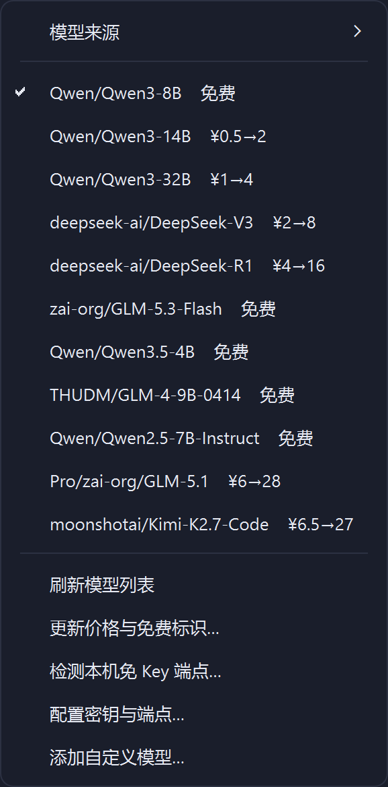
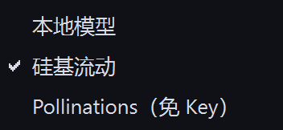

# 免费模型排查与免 Key 端点接入（1.0.10）

> 起因：用户截图反馈「硅基流动里的 Qwen3-14B，我看这个不是免费的呀」。
> 截图显示该模型 输入 ¥0.000500 / K Tokens、输出 ¥0.002000 / K Tokens
> （即 ¥0.5 / ¥2 每百万 tokens），而客户端菜单却给它标了「免费」。

## 1. 结论先说

| 问题 | 结论 |
|---|---|
| 客户端为什么标错 | 「免费」来自一份**手工维护**的 `KNOWN_FREE` 清单（12 条），服务商改价后清单没跟着变 |
| 错标了几条 | 4 条收费模型被标免费；另有 4 条早已下架、1 条漏标 |
| 现在怎么判定 | 抓官方价格页（`https://siliconflow.cn/models`）的 SSR 数据，**输入与输出都为 0 元才算免费**；内置价格快照 + 24h 在线刷新 |
| 有没有不用 Key 的在线模型 | 有，但极少。实测可用：**Pollinations**（`https://text.pollinations.ai`，模型 `openai-fast`，背后 GPT-OSS-20B，支持 tools / 流式） |
| 还有哪些免 Key | 本机跑起来的 **Ollama** / **LM Studio**（完全本地，零成本），已做成「一键检测接入」 |

## 2. 硅基流动：62 个 chat 模型，11 个真免费（2026-10-26 官方价格页口径）

### 2.1 真免费（输入 / 输出都是 0 元）

| 模型 | 类型 | 备注 |
|---|---|---|
| `Qwen/Qwen3-8B` | 通用 | 主力免费款，性价比最高 |
| `Qwen/Qwen3.5-4B` | 通用 | 小尺寸、响应快 |
| `Qwen/Qwen2.5-7B-Instruct` | 通用 | 老款稳定 |
| `zai-org/GLM-5.3-Flash` | 通用 | 智谱 Flash 系列 |
| `THUDM/GLM-4-9B-0414` | 通用 | 智谱开源 |
| `THUDM/GLM-Z1-9B-0414` | 推理 | 先思考后作答 |
| `XingChenAGI/Xing4.0-29B` | 通用 | 星尘 |
| `deepseek-ai/DeepSeek-R1-0528-Qwen3-8B` | 推理 | R1 蒸馏小模型 |
| `tencent/Hunyuan-MT-7B` | 翻译 | 专款专用，中英互译 |
| `deepseek-ai/DeepSeek-OCR` | 文档识别 | 扫描件 / 截图转文本 |
| `PaddlePaddle/PaddleOCR-VL-1.5` | OCR / 视觉 | 版面识别 |

另有 10 个非 chat 的免费资源（不计入模型菜单，供参考）：`BAAI/bge-m3`、
`bge-large-zh-v1.5`、`bge-large-en-v1.5`（embedding）、`bge-reranker-v2-m3`（rerank）、
`Qwen/Qwen3-ASR-1.7B` 等 5 个语音识别、`Kwai-Kolors/Kolors`（生图）。

### 2.2 被旧清单**错标成免费**的（实际收费）

| 模型 | 真实价格（¥/百万 tokens） | 说明 |
|---|---|---|
| `Qwen/Qwen3-14B` | 输入 0.5 / 输出 2 | 用户反馈的那一个 |
| `Qwen/Qwen3-32B` | 输入 1 / 输出 4 | |
| `deepseek-ai/DeepSeek-R1` | 输入 4 / 输出 16 | |
| `deepseek-ai/DeepSeek-V3` | 输入 2 / 输出 8 | |

### 2.3 旧清单里已经**下架**的（选了会 404）

`Qwen/Qwen2.5-Coder-7B-Instruct`、`THUDM/glm-4-9b-chat`、
`meta-llama/Llama-3.1-8B-Instruct`、`meta-llama/Meta-Llama-3.1-8B-Instruct`。

## 3. 免 Key 的模型：能用的就这三类

### 3.1 本机引擎（本来就有，零成本）

llmBuddy 自带的 `llama-server` 引擎，模型完全跑在本机，不需要 Key、不计费。

### 3.2 本机 Ollama / LM Studio（一键检测接入）

| 端点 | 默认地址 | 说明 |
|---|---|---|
| Ollama | `http://127.0.0.1:11434/v1` | `ollama serve` 后可用，自带 OpenAI 兼容层 |
| LM Studio | `http://127.0.0.1:1234/v1` | 打开 Local Server 后可用 |

菜单 →「检测本机免 Key 端点…」→ 自动探测并接入（写入 `base_url` / 首个模型 /
`keyless`）。注意 **8000 端口被排除**：那是 llmBuddy 自己的网关，误接会死循环。

### 3.3 Pollinations（在线、无需 Key，已实测）

| 项 | 值 |
|---|---|
| 端点 | `https://text.pollinations.ai`（`Provider` 拼 `/v1/chat/completions`） |
| 模型 | `openai-fast`（匿名档唯一；别名 `openai` / `gpt-oss-20b`） |
| 背后 | GPT-OSS 20B Reasoning（OVH 托管） |
| 能力 | 流式、`reasoning`、**工具调用**（2026-10-26 实测 `tool_calls` 正常返回） |
| 限制 | 匿名档限流低，忙时 429/503 属正常 |

**必须如实告知的边界**：这是第三方公益聚合服务，不是模型官方；内容会经过第三方
服务器，**不要发敏感 / 隐私内容**；服务可能随时调整或关停。适合「随手试试」，
不适合当生产通道。

### 3.4 那些「免费但需要 Key」的平台（不算免 Key）

智谱（GLM Flash 系列）、ModelScope 魔搭、Groq、Google Gemini、OpenRouter 的
`:free` 模型、Cloudflare Workers AI、GitHub Models 等，都有免费额度，但**都要先
注册拿 Key**。额度与在架模型名变动频繁，客户端不写死，用「自定义（OpenAI 兼容）」
填端点 + Key 即可接入。

> 刻意不做：各类「逆向免 Key」方案（gpt4free、DDG 非官方接口等）违反服务条款、
> 随时失效，且会把聊天内容送给来源不明的中转，不做。

## 4. 实现（改动清单）

### 4.1 单一事实来源：价格表

`client/core/model_info.py`

- 新增 `PRICE_SNAPSHOT`（62 个 chat 模型的输入/输出价，元每百万 tokens，带 `SNAPSHOT_DATE`）；
- `KNOWN_FREE` 改为**由快照推导**（`(0, 0)` 才算免费），不再手写；
- `is_free()` 删掉 `"free" in id.lower()` 这个危险启发式（会把任何名字带 free 的
  模型当免费），价格未收录一律按「按量计费」；
- `set_live_pricing()` 允许运行期用在线价格覆盖快照；
- `menu_label()` 收费模型直接显示单价（`Qwen/Qwen3-14B    ¥0.5→2`），
  `describe()` 的 tooltip 写清「输入 ¥0.5、输出 ¥2 每百万 tokens」。

### 4.2 在线刷新（避免再次过期）

`client/core/model_pricing.py`（新增）

- `parse_pricing(html)`：从官方价格页 SSR 内嵌 JSON 里按 `modelName` 切段取
  `pricing[prompt/completion]`，只收 `subType=chat`；
- **解析失败返回空表**，绝不把「解析不出来」当成「都免费」；
- 缓存 `%LOCALAPPDATA%\llmBuddy\cache\siliconflow_pricing.json`，TTL 24h；
- `refresh()` 抓页 → 解析 → 落盘 → 注入；`apply_cached()` 启动时读缓存不联网
  （`client/main.py` 启动即调用）。

### 4.3 免 Key 提供商

- `core/assistant/store.py`：默认 providers 增加 `pollinations`（enabled、`keyless`）、
  `ollama` / `lmstudio`（disabled，等检测到再启用）；`POLLINATIONS_BASE_URL`
  只写到域名（写 `.../openai` 会被拼成 `/openai/v1/chat/...`）。
- `core/assistant/agent.py`：state 下发 `keyless`，前端据此显示「免 Key」而不是
  「尚未配置 API Key」。
- `client/core/local_endpoints.py`（新增）：探测 11434 / 1234，只返回真能用且
  至少有一个模型的端点。
- `client/ui/pages/assistant_page.py`：模型菜单新增「更新价格与免费标识…」、
  「检测本机免 Key 端点…」；模型项对免 Key 来源标「免 Key」。

### 4.4 顺手修掉的坑：死代理

`core/assistant/providers.py` 新增 `env_proxy_usable()`：环境里的本机代理
（`HTTPS_PROXY` 指向 `127.0.0.1:端口`）**端口没人监听**时，`_client()` 自动改直连
（`trust_env=False`）。本机环境常年残留指向已退出代理进程的 `64422`，以前表现是
「一直转圈」而不是明确报错。

## 5. 效果

菜单里一眼可辨：`免费` 是真 0 价，`¥0.5→2` 是「输入 0.5、输出 2 元每百万 tokens」。

## 6. 验证记录（2026-10-26）

| 项目 | 结果 |
|---|---|
| 官方价格页解析 | 62 个 chat 模型 / 11 个免费，与人工核对一致 |
| 在线刷新 | `count=62 free=11 at 2026-10-26 16:00`，缓存已落盘 |
| Pollinations 直连 | `/v1/chat/completions` 200；流式 47 个增量；`tool_calls` 正确返回 |
| 死代理自愈 | 指向空端口时 `env_proxy_usable()=False`，`Client.trust_env=False` |
| 后端测试 | `235 passed, 1 skipped`（新增 `tests/test_assistant_keyless.py` 10 条） |
| 客户端测试 | `340 passed`（新增 `client/ui_tests/test_model_pricing.py` 23 条 + 助理页 7 条） |

## 7. 使用建议

- 日常随便聊聊 → 用 `Qwen/Qwen3-8B`（免费、够快）。
- 要读图 / 识别文档 → `deepseek-ai/DeepSeek-OCR` 或 `PaddleOCR-VL-1.5`（免费）。
- 纯翻译 → `tencent/Hunyuan-MT-7B`（免费）。
- 不想注册任何平台 → 本机模型，或「检测本机免 Key 端点」接 Ollama；
  想试在线大模型 → `Pollinations`（免 Key，但别发隐私内容）。
- 价格随时会调，选之前用菜单里的「更新价格与免费标识…」刷一次即可。
