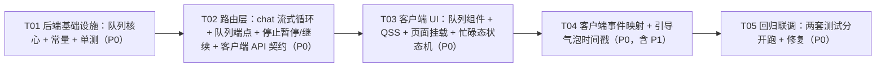

# 智能助理 · 引导会话（消息排队）增量架构设计

> 版本：v1（增量） · 作者：高见远（架构师） · 日期：2026-08-08
> 关联文档：`docs/智能助理-引导会话-PRD.md`（产品需求）、`docs/智能助理.md`（1.0.8 功能基线）
> 代码基线：1.0.8（`routers/assistant.py` / `core/assistant/agent.py` / `client/ui/pages/assistant_page.py`）

---

## Part A：系统设计

### 1. 实现方案

#### 1.1 技术难点分析

| # | 难点 | 现状（代码事实） | 方案 |
|---|------|------------------|------|
| D1 | **忙碌态插话不能打断当前轮** | `AssistantPage._on_send_clicked()`（L1609）在 `_busy=True` 时直接 `return`，消息被丢弃；`chat` 每次 POST 都会新开一条 SSE 流并 `start_turn` | 入队/引导走 **REST 短请求**（`stream=false`），不新开流；当前轮的 SSE 流与 agent 线程完全不受影响 |
| D2 | **本轮结束自动消费下一条** | `agent.py` 的 `start_turn()` 是「一轮一职责」阻塞函数，末尾固定 `emit({"type": "end"})`；单测与非流式路径共用，不能改 | 消费循环放在**路由层 SSE `gen()`**：`start_turn` 返回后检查队列，非空则**在同一条连接内**起新线程再跑一轮；`agent.py` 零改动 |
| D3 | **`end` 事件语义收紧** | 客户端 `_on_event("end")` → `_end_streaming()` 解除忙碌态；中间轮次不能再发 `end` | `gen()` **吞掉** agent 的单轮 `end`（只记录最后一轮 content/error），仅在「队列耗尽 / 暂停」时下发一次统一的 `end` + `[DONE]`；单轮完成仍由既有 `done` 事件表达 |
| D4 | **停止 = 取消 + 队列暂停** | `POST /stop` 只调 `Assistant.stop(sid)`（置取消标志） | `/stop` 增加 `queue.set_paused(sid, True)` + 广播 `queue_state`；**不出队、不清空**；客户端停止区/队列头部提供「继续」（`POST /chat mode=resume`） |
| D5 | **引导消息「进了对话流但未落库」** | 会话 messages 由 `start_turn` 在轮首追加用户消息；当前轮进行中插入会打乱「用户消息 → assistant 回复」顺序 | 引导消息**出队时才写入 session messages**（沿用 `start_turn` 现有逻辑）；`guided` 事件让客户端**立即渲染用户气泡 + HH:MM**；未消费的引导消息刷新后从对话流消失（已知限制，P2-3 落库） |
| D6 | **多客户端 / 多入口状态一致** | 队列操作来自 REST（编辑/删除/排序），而渲染依赖 SSE 流 | 路由层维护 `_STREAM_SINKS: Dict[session_id, asyncio.Queue]`；所有队列变更**广播 `queue` 全量快照**；客户端以快照为单一事实来源重渲染 |

#### 1.2 框架与库选型（无新增依赖）

- **队列核心**：纯标准库 `threading.RLock` + `collections.deque` + `dataclasses`（`core/assistant/queue.py`）。per-session 队列、条目不可变 id、快照方法供 SSE 广播。不引入 Redis/DB——队列生命周期 ≤ 一个忙碌期，P2 再落库。
- **后端 Web**：FastAPI 现有能力。`StreamingResponse` 的 `gen()` 改为「多轮循环」；REST 队列端点复用现有 `APIRouter(prefix="/api/v1/assistant")` 与 `{code, message, data}` 风格（`ok()/fail()`）。
- **客户端**：PySide6 现有能力。队列车 = 普通 `QFrame` + `QHBoxLayout` + `QPushButton`（objectName + QSS，与 `#ThinkingBlock`/`#Composer` 一脉相承）；行内编辑用 `QLineEdit` 内联（**不用模态框**，无头测试可驱动）；入队/引导的 REST 调用复用 `core.task_runner.Worker`（线程池 + 信号回主线程）。
- **架构模式**：后端沿用「路由层编排 + agent 单轮语义」的分层；客户端沿用「页面状态机（`_busy`）+ 事件分发（`_on_event`）+ 快照重渲染」。**不引入新架构**。

#### 1.3 关键设计决策（主理人已拍板，作为实现约束）

1. 停止语义 = 取消当前轮 + **队列暂停**（不自动消费、不清空），提供「继续」入口（`chat` 带 `mode=resume`）。
2. 引导消息**出队时才写入 session messages**；未消费引导消息刷新后消失（已知限制，P2 落库）。
3. 交互：忙碌时 ↑=排队入队；↑ 左侧新增次级按钮 ⚡=引导发送；Enter=排队 / Shift+Enter=引导；空闲态保持现状。
4. 队列上限 **20 条**，超出时提示且不入队（消息保留在输入框）。
5. 消费触发在**路由层**（SSE `gen()` 内 `start_turn` 返回后检查队列续跑），不改 `agent.py` 单轮语义；**严格 FIFO**，引导不设优先权。

补充决策（架构师裁定，PRD 未明说）：
6. **出错也继续消费**：某一轮 `error`（模型故障/工具上限）只影响该轮，`gen()` 继续出队下一条，保证「不丢失」；每条错误轮次都有 `error` 事件可见。
7. **「全部清除」不清引导消息**（引导已登记对话流，清了即丢失，违背「不丢失」目标），tooltip 明示。
8. **服务端「有活跃流」判据 = `_STREAM_SINKS` 是否持有该会话**；客户端 `_busy` 与服务端短暂不一致时，服务端向「退化为普通发送」收敛，不报错。

---

### 2. 文件清单

#### 2.1 新增

| 文件 | 职责 |
|------|------|
| `core/assistant/queue.py` | 引导会话队列核心：`QueueItem`（条目 dataclass）、`AssistantQueue`（per-session `deque` + 锁 + 暂停标志 + 已出队记忆）、`QueueError`（带业务错误码）、`get_queue()` 单例、SSE 事件名常量、错误码常量、`hhmm()` 时间格式化 |
| `client/ui/widgets/queue_item.py` | `QueueItemRow` 队列车组件：序号 + 单行省略文本（hover 全文）+ 行内编辑（QLineEdit，非模态）+ ✎/↑/↓/✕；引导行为只读行（⚡ 标记、无操作按钮）；信号 `saved/removed/moved/edit_cancelled` |
| `tests/test_assistant_queue.py` | 队列核心单元测试（后端套）：FIFO、上限 20、编辑/删除/上移下移/清空（不清引导）、`pop_next`、暂停、已出队 2015、引导只读 2016、`drop_session` |

#### 2.2 修改

| 文件 | 改动点 |
|------|--------|
| `core/assistant/__init__.py` | 导出 `get_queue` / `QueueItem` / `QueueError`（与 `get_assistant` 一致的对外面） |
| `routers/assistant.py` | ① `chat` 增加 `mode`（`normal/queue/guided/resume`）；② `gen()` 改多轮消费循环 + 吞单轮 `end` + 收紧 `end`/`[DONE]`；③ 新增队列 REST 端点（GET/PATCH/DELETE/move/clear）；④ `/stop` 置暂停 + 广播；⑤ 删除会话时 `drop_session`；⑥ `_STREAM_SINKS` / `_broadcast` / `_queue_snapshot_event`；⑦ 文件头接口清单 docstring 补新端点 |
| `tests/test_assistant.py` | 追加路由层测试：入队广播、gen 多轮 FIFO 消费（唯一 `end` 在末尾）、stop 暂停、resume 空队列 400/2013、队列端点错误码 |
| `client/core/assistant_client.py` | `post/patch/delete` 增加可选 `params`；新增 `queue/enqueue/queue_update/queue_delete/queue_move/queue_clear` 封装 |
| `client/ui/pages/assistant_page.py` | ① `_build_footer` 在 composer 之上插入队列面板（`_build_queue_panel`）；② composer 增加 `_guide_btn`（⚡，仅忙碌可见）；③ `_set_busy_controls()` 状态机（tooltip/placeholder/按钮显隐）；④ `eventFilter` Enter/Shift+Enter 按忙碌态分支；⑤ `_on_send_clicked` 忙碌 → `_enqueue_message`；⑥ `_enqueue_message/_on_guide_clicked/_apply_queue/_rebuild_queue_rows/_queue_saved/_queue_removed/_queue_moved/_queue_clear/_fetch_queue/_resume_queue`；⑦ `_stop` 串行化（stop → 拉快照）并保留暂停态；⑧ `_on_event` 新增 `queued/guided/dequeued/queue/queue_state` 分支、`end` 分支补暂停提示；⑨ `_apply_session_detail`/`_clear_chat` 重置并同步新会话队列 |
| `client/ui/widgets/assistant_cards.py` | `ChatBubble.__init__` 增加可选 `time_text`：为真时在气泡下追加右/左对齐的 `#BubbleTime` 小标签（HH:MM）；复制沿用既有 `TextSelectableByMouse` |
| `client/core/theme.py` | `_LIGHT_OVERRIDE` 追加浅色 QSS：`#QueuePanel/#QueueHead/#QueueTitle/#QueueClearBtn/#QueueResumeBtn/#QueueBody/#QueueRow/#QueueIdx/#QueueText/#QueueOp/#GuideBtn/#BubbleTime` |
| `client/resources/styles.qss` | 深色基线 QSS 追加同名选择器（放在 `#Composer` 区附近） |
| `client/ui_tests/test_assistant_page.py` | `_FakeAssistApi` 增加队列方法（含 `queue_error` 故障注入）；新增无头用例：忙碌态按钮/placeholder/tooltip、Enter 入队、Shift+Enter 引导、guided/dequeued 气泡与时间、done 不结束忙碌而 end 结束、队列面板显隐与行数、停止→暂停→继续、编辑/删除/移动/清除 REST 参数、入队失败保留输入 |

---

### 3. 数据结构与接口

#### 3.1 后端：队列条目与队列管理器

```python
# core/assistant/queue.py（签名级骨架，非完整实现）
MAX_QUEUE_ITEMS = 20      # 单会话排队上限（主理人拍板）
RECENT_KEEP     = 64      # 已出队条目记忆数（区分「已出队」与「不存在」）

EV_QUEUED, EV_QUEUE, EV_GUIDED, EV_DEQUEUED, EV_QUEUE_STATE = \
    "queued", "queue", "guided", "dequeued", "queue_state"

ERR_QUEUE_FULL, ERR_QUEUE_EMPTY, ERR_ITEM_NOT_FOUND, \
ERR_ITEM_DISPATCHED, ERR_GUIDED_READONLY, ERR_SESSION_BUSY = \
    2012, 2013, 2014, 2015, 2016, 2017

@dataclass
class QueueItem:
    id: str                 # "q" + uuid4().hex[:10]
    text: str
    guided: bool            # True=引导（只读，已登记对话流）
    created_at: float       # epoch
    edited_at: Optional[float] = None
    def to_dict(self) -> dict: ...   # {id, text, guided, time: "HH:MM", created_at, edited_at}

class QueueError(Exception):
    code: int; message: str

class AssistantQueue:
    def enqueue(self, session_id: str, text: str, guided: bool = False) -> QueueItem
    def update(self, session_id: str, item_id: str, text: str) -> QueueItem     # 排队中可改；引导/已出队抛错
    def remove(self, session_id: str, item_id: str) -> str                       # 引导不可删
    def move(self, session_id: str, item_id: str, delta: int) -> List[dict]      # delta ∈ {-1,+1}
    def clear(self, session_id: str) -> int                                      # 只清非引导，返回清除数
    def pop_next(self, session_id: str) -> Optional[QueueItem]                   # FIFO 出队并记入 _recent
    def is_paused(self, session_id: str) -> bool
    def set_paused(self, session_id: str, paused: bool) -> None
    def snapshot(self, session_id: str) -> List[dict]                            # [item.to_dict(), ...] 按 FIFO
    def pending_count(self, session_id: str) -> int
    def drop_session(self, session_id: str) -> None                              # 会话删除时清理

def get_queue() -> AssistantQueue    # 模块级单例（同 get_assistant 模式）
def hhmm(ts: float) -> str           # time.strftime("%H:%M", time.localtime(ts))
```

#### 3.2 SSE 事件协议（在既有事件体系上扩展）

既有事件（`start/model/delta/reasoning/replace/tool_call/tool_result/approval_*/skill_step/title/note/done/error/stopped`）全部不变。新增/收紧如下：

| 事件 | 字段 | 语义 |
|------|------|------|
| `queued` | `id, text, time, index` | 入队确认（`index` = 入队后在队列中的位次）；客户端映射为 StepLine 提示 |
| `guided` | `id, text, time` | 引导消息已登记：客户端**立即渲染用户气泡（带 HH:MM）+ StepLine**；不写 session、不打断当前轮 |
| `dequeued` | `id, text, mode, time` | 消息出队、即将作为下一轮处理；`mode ∈ queue/guided`：`queue` 补用户气泡，`guided` 只加 StepLine（气泡已在 `guided` 时渲染，不重复） |
| `queue` | `items[], paused` | 队列**全量快照**（任何变更 / 新轮次开始 / resume 起流时广播）；客户端以此为准重渲染面板 |
| `queue_state` | `paused, reason?` | 暂停/恢复transition：停止后 `paused=true, reason="stopped"`；resume 后 `paused=false`；客户端切 StepLine + 「继续」按钮显隐 |
| `end`（收紧） | `content, error, paused` | **仅在队列耗尽或暂停时**发出一次（`paused` 透传当前暂停态）；客户端据此 `_end_streaming()` |

要点：
- agent 的**单轮 `end` 被 `gen()` 吞掉**（只记录 `last={content,error}`），不下发；单轮完成仍由 `done` 表达。
- 中间轮次客户端忙碌态不中断：`done` → 收尾当前气泡；`dequeued` → 补下一条用户气泡；下一轮 `start/delta/...` 继续推。
- REST 变更（编辑/删除/排序/清除）走 HTTP 响应返回结果，同时向活跃流广播 `queue` 快照。

#### 3.3 REST 端点表（前缀 `/api/v1/assistant`，鉴权与错误风格沿用现有 `ok()/fail()`）

| 方法 | 路径 | 请求 | 响应 |
|------|------|------|------|
| POST | `/chat` | `{session_id, message, mode, provider, model, stream}`；`mode ∈ normal/queue/guided/resume` | `normal`：SSE 流（现状）；`queue/guided` 且有活跃流：`ok({queued: item, paused})` JSON；`queue/guided` 无活跃流：退化为 `normal`；`resume`：SSE 流（出队头条开轮） |
| GET | `/queue` | `?session_id=` | `ok({items:[...], paused})` |
| PATCH | `/queue/{id}` | `?session_id=`，body `{text}` | `ok(item.to_dict())`；已出队 2015 / 引导 2016 / 不存在 2014 |
| DELETE | `/queue/{id}` | `?session_id=` | `ok({deleted:id})`；引导不可删 2016 / 不存在 2014 |
| POST | `/queue/{id}/move` | `?session_id=`，body `{delta: -1\|+1}` | `ok({items})`；越界 2002 / 不存在 2014 |
| POST | `/queue/clear` | `?session_id=` | `ok({cleared:n})`（不清引导） |
| POST | `/stop` | `{session_id}` | 现状 + `set_paused(True)` + 广播 `queue_state`/`queue` |

错误码约定：`0` 成功；`2002` 参数错；`2012` 队列满（20）；`2013` 队列空（resume）；`2014` 消息不存在；`2015` 已出队；`2016` 引导只读；`2017` 会话正在执行中（resume 竞态兜底）。**唯一 HTTP 非 200**：`resume` 遇空队列返回 `400 + fail(2013)`（该路径走 SSE 流，客户端靠 `AssistantStream.failed` 提示）。

#### 3.4 路由层广播设施（`routers/assistant.py` 模块级）

```python
_STREAM_SINKS: Dict[str, "asyncio.Queue"] = {}   # session_id -> 活跃 SSE 流的事件队列

def _broadcast(session_id: str, event: dict) -> None:
    q = _STREAM_SINKS.get(session_id)
    if q is not None:
        q.put_nowait(event)          # 全程在事件循环线程调用，无需额外锁

def _queue_snapshot_event(session_id: str) -> dict:
    q = get_queue()
    return {"type": EV_QUEUE, "items": q.snapshot(session_id), "paused": q.is_paused(session_id)}
```

`gen()` 主体（伪代码）：

```python
async def gen():
    q = asyncio.Queue(); loop = asyncio.get_running_loop()
    _STREAM_SINKS[session_id] = q
    def emit(ev): loop.call_soon_threadsafe(q.put_nowait, ev)
    last = {"content": "", "error": ""}
    try:
        yield _sse({"type": "session", "session_id": session_id})
        if mode == "resume":
            yield _sse({"type": EV_QUEUE_STATE, "paused": False})
        yield _sse(_queue_snapshot_event(session_id))     # 起流即同步快照
        text_now = first_text                             # normal=输入文本；resume=队头条
        while text_now:
            def run(t=text_now):
                try: ass.start_turn(session_id, t, provider_id, model, emit)
                except Exception as e: emit({"type": "error", "message": f"{type(e).__name__}: {e}"})
                finally: loop.call_soon_threadsafe(q.put_nowait, None)
            threading.Thread(target=run, daemon=True, name=f"assistant-{session_id}").start()
            while True:
                ev = await q.get()
                if ev is None: break
                if ev.get("type") == "end":              # 吞掉单轮 end
                    last = {"content": ev.get("content") or "", "error": ev.get("error") or ""}
                    continue
                yield _sse(ev)
            if get_queue().is_paused(session_id):        # 停止→暂停：收流
                yield _sse({"type": EV_QUEUE_STATE, "paused": True, "reason": "stopped"})
                break
            nxt = get_queue().pop_next(session_id)       # FIFO 消费下一条
            if nxt is None: break                        # 队列耗尽
            yield _sse({"type": EV_DEQUEUED, "id": nxt.id, "text": nxt.text,
                        "mode": "guided" if nxt.guided else "queue", "time": hhmm(nxt.created_at)})
            yield _sse(_queue_snapshot_event(session_id))
            text_now = nxt.text
        yield _sse({"type": "end", "content": last["content"], "error": last["error"],
                    "paused": get_queue().is_paused(session_id)})
        yield "data: [DONE]\n\n"
    finally:
        if _STREAM_SINKS.get(session_id) is q:           # 防双流互踩
            _STREAM_SINKS.pop(session_id, None)
```

#### 3.5 客户端：状态与接口

```python
# AssistantPage 新增状态（__init__）
_queue_items: List[Dict]        # 当前会话队列快照（以后端 queue 事件为准）
_queue_paused: bool
_queue_panel / _queue_head_lbl / _queue_clear_btn / _queue_resume_btn / _queue_body / _queue_rows: Dict[str, QueueItemRow]

# 关键方法
_set_busy_controls()            # 忙碌态状态机（见 3.6）
_enqueue_message(text, guided)  # REST 入队/引导；失败保留输入框文本
_on_guide_clicked()             # ⚡ / Shift+Enter
_apply_queue(items, paused)     # 快照 → 重渲染面板 + 显隐 + 继续按钮
_fetch_queue(sid)               # GET /queue（停止后、切换任务后同步）
_resume_queue()                 # POST /chat mode=resume → 新 SSE 流 + _begin_streaming()
_stop()                         # 现状 + 串行：stop 成功后再拉队列快照
```

#### 3.6 忙碌时发送区状态机（PRD 4.2 落地规则）

| 状态 | ↑（`_send_btn`） | ⚡（`_guide_btn`，新增） | ■（`_stop_btn`） | 「继续」（`_queue_resume_btn`） | 输入框 placeholder |
|------|------------------|--------------------------|------------------|-------------------------------|---------------------|
| 空闲 | 发送（现状） | **隐藏** | 隐藏（现状） | 隐藏 | 「今天帮你做些什么？（Enter 发送，Shift+Enter 换行）」 |
| 忙碌 | **排队入队** | **引导发送** | 显示（现状） | 隐藏 | 「执行中：Enter 排队 · Shift+Enter 引导发出（不打断当前生成）」 |
| 停止后暂停（队列非空、空闲） | 发送 | 隐藏 | 隐藏 | **显示**（点「继续」按序发送） | 空闲态文案 |

- ↑ tooltip：空闲「发送（Enter）」/ 忙碌「排队发送（Enter）：不打断当前生成，本轮结束后按序自动发送」。
- ⚡ tooltip：「引导会话（Shift+Enter）：消息立即发出并登记进对话流，但不会中断当前生成」。
- 键盘（`eventFilter`）：Enter → 空闲发送 / 忙碌排队；Shift+Enter → 空闲换行（现状）/ 忙碌引导。
- 队列面板：`_queue_items` 非空才可见（空队列/空闲不占布局）；引导行只读（⚡ + 文本，无 ✎/↑/↓/✕）；首条禁用 ↑、末条禁用 ↓。

---

### 4. 程序调用流程

四条关键路径的时序图已抽取至 `docs/智能助理-引导会话-时序图.mermaid`（排队 / 引导 / 本轮结束自动消费 / 停止+暂停+继续），类图至 `docs/智能助理-引导会话-类图.mermaid`。要点速览：

1. **排队路径**：Enter（忙碌）→ `_enqueue_message` → `POST /chat mode=queue` → `AssistantQueue.enqueue` → 广播 `queued` + `queue` 快照 → 客户端 StepLine + 面板新行；当前轮 agent 线程无感知。
2. **引导路径**：Shift+Enter/⚡ → `mode=guided` → `enqueue(guided=True)` → 广播 `guided` + `queue` → 客户端**立即渲染用户气泡（HH:MM）**；未写 session，出队时才落库。
3. **自动消费**：agent 单轮 `end` 被 `gen()` 吞掉 → 查暂停 → `pop_next` → `dequeued` + 快照 → 同连接起新线程 `start_turn` → … → 队列空 → 唯一一次 `end` + `[DONE]` → 客户端解除忙碌。
4. **停止+暂停+继续**：■ → 本地断流 + `POST /stop`（取消 + `set_paused(True)`）→ 成功回调里 `GET /queue` 拉快照 → 面板保留 + 「继续」可见 → 点「继续」→ `POST /chat mode=resume` → 解暂停 + 出队头条 → 新 SSE 流回到路径 3。

---

### 5. 待明确事项（Anything UNCLEAR）

1. **「全部清除」是否也要清引导消息？** 设计定为**不清**（引导已登记对话流，清了即丢失，违背「不丢失」目标）；tooltip 明示「引导消息不可清除」。若产品希望连引导一起清，需改 `AssistantQueue.clear()` 并接受丢消息——建议找产品经理确认。
2. **队列面板是否显示引导消息行？** 设计定为**显示**（只读行），依据 PRD 5.1「未消费引导消息刷新后仅队列可见」。若产品认为对话流已显示、队列里重复反而乱，可在 `_rebuild_queue_rows` 过滤 `guided=True`（一行改动）。
3. **多客户端实时同步**：`_STREAM_SINKS` 每会话只持有一个流（后开覆盖先开），广播只达最新流；其余客户端靠自身 REST 响应更新。P0 单用户场景够用，P2-3 完善。
4. **客户端/服务端忙碌态短暂不一致**（如停止后瞬间点继续）：服务端 `resume` 可能撞上尚未退出的 gen，返回 `2017`，客户端状态栏提示重试。窗口很小（客户端断开 → 服务端 gen 随即退出），可接受。
5. **后端重启丢队列**：内存队列不持久化，重启后客户端按空队列处理（PRD 已知限制，P2-3 落库）。
6. 无新增第三方依赖、无新增构建/配置文件——本增量为纯 Python 增量，`T01` 的「基础设施」形态为「队列核心模块 + 共享常量 + 测试基建」。

---

## Part B：任务分解

### 6. 依赖包清单

**无新增依赖**（明说）：

- 后端：Python 标准库（`threading` / `collections.deque` / `dataclasses` / `uuid` / `time` / `typing`）+ 现有 FastAPI（`StreamingResponse` / `APIRouter` / `JSONResponse`）——现有能力够用。
- 客户端：现有 PySide6（`QThread` / `Signal` / `QFrame` / `QLineEdit` / `QPushButton`）+ 现有 `httpx` / `core.task_runner.Worker`——现有能力够用。
- 不引入 WebSocket、不引入前端构建链、不引入任何新 pip 包。

### 7. 任务列表（按实现顺序，共 5 个）

#### T01 · 后端基础设施：引导会话队列核心 + 共享常量 + 单元测试 （P0）

- **Source Files**：
  - `core/assistant/queue.py`（新增）：`QueueItem` / `AssistantQueue` / `QueueError` / `get_queue()` / `hhmm()` / 事件名与错误码常量（内容见 3.1）
  - `core/assistant/__init__.py`（修改）：导出 `get_queue` / `QueueItem` / `QueueError`
  - `tests/test_assistant_queue.py`（新增）：队列单元测试
- **Dependencies**：无
- **验收点**：
  - FIFO：连续入队 3 条，`snapshot` 顺序与 `pop_next` 顺序一致；
  - 上限：第 21 条 `enqueue` 抛 `QueueError(2012)`，前 20 条完好；
  - 编辑/删除：排队中可改可删；引导条目 `update/remove` 抛 `2016`；`pop_next` 后 `update/remove` 抛 `2015`；未知 id 抛 `2014`；
  - 排序：`move(delta=-1)` 首条抛错、末条 `+1` 抛错，中间条目交换正确；
  - `clear` 只清非引导并返回清除数；`set_paused/is_paused`；`drop_session` 清空该会话全部状态；
  - `python -m pytest tests/test_assistant_queue.py -q` 全绿（该文件不依赖 `env` 夹具，纯单测）。

#### T02 · 路由层：chat 流式循环改造 + 队列 REST 端点 + 停止暂停/继续 + 客户端 API 契约 （P0）

- **Source Files**：
  - `routers/assistant.py`（修改）：`chat` 增加 `mode`（含入队分支、resume 分支、空队列 400+2013、resume 撞活跃流 2017）；`gen()` 按 3.4 改造（多轮循环、吞单轮 `end`、`dequeued`/`queue` 广播、sink 注册/防踩踩注销）；新增 `GET/PATCH/DELETE /queue`、`POST /queue/{id}/move`、`POST /queue/clear`；`/stop` 加暂停+广播；`session_delete` 加 `drop_session`；文件头 docstring 补端点清单
  - `client/core/assistant_client.py`（修改）：`post/patch/delete` 增加可选 `params`；新增 `queue/enqueue/queue_update/queue_delete/queue_move/queue_clear`
  - `tests/test_assistant.py`（修改）：追加路由层测试（见验收点）
- **Dependencies**：T01
- **验收点**：
  - 入队广播：向 `api._STREAM_SINKS[sid]` 注册 asyncio.Queue 后 `asyncio.run(api.chat({... "mode": "queue", "stream": False}))` 返回 `code=0`，且假 sink 依次收到 `queued`、`queue` 事件；
  - 多轮 FIFO 消费：`FakeProvider` 预设 3 条回复，预置队列 2 条，drain `chat(stream=True)` 的 `body_iterator` → 事件序列含 3 个 `done`、2 个 `dequeued`（id/text 正确）、**恰好 1 个 `end` 且在末尾**、终止于 `[DONE]`；session messages = 3 user + 3 assistant（FIFO 落库）；
  - 暂停/继续：`/stop` 后 `is_paused=True`；`mode=resume` 空队列返回 HTTP 400 + `fail(2013)`；非空时出队头条并解暂停；
  - 队列端点：PATCH/DELETE/move/clear 正常路径 + 2012/2014/2015/2016 错误码；DELETE 会话后队列清空；
  - 客户端封装：新方法 URL/method/参数与端点表一致（客户端套单测断言，见 T03）。

#### T03 · 客户端 UI：队列组件 + QSS + 页面挂载 + 忙碌态状态机 （P0）

- **Source Files**：
  - `client/ui/widgets/queue_item.py`（新增）：`QueueItemRow`（见 2.1）
  - `client/ui/pages/assistant_page.py`（修改）：`_build_footer` 插入 `_build_queue_panel()`；composer 增加 `_guide_btn`；`_set_busy_controls()`；`eventFilter`/`_on_send_clicked`/`_on_guide_clicked`/`_enqueue_message`；`_apply_queue`/`_rebuild_queue_rows`；`_queue_saved/_queue_removed/_queue_moved/_queue_clear/_fetch_queue`；`_resume_queue`；`_stop` 串行化 + 乐观暂停；`_apply_session_detail`/`_clear_chat` 重置同步队列
  - `client/core/theme.py`（修改）+ `client/resources/styles.qss`（修改）：新增 QSS 选择器（深色基线 + 浅色覆盖，建议值见 8.6）
  - `client/ui_tests/test_assistant_page.py`（修改）：`_FakeAssistApi` 增加队列方法（`enqueue/queue/queue_update/queue_delete/queue_move/queue_clear` + `queue_error` 故障注入）
- **Dependencies**：T02
- **验收点**：
  - `_begin_streaming()` 后 `_guide_btn` 可见、`_end_streaming()` 后隐藏；tooltip/placeholder 按 3.6 表切换；
  - 忙碌态 `_on_send_clicked()` → `_pump` 到 `fake.enqueued == [(sid, text, False)]`，输入框清空、**未新建 AssistantStream**；`_on_guide_clicked()` → `guided=True`；
  - 入队失败（`queue_error`）→ 输入框文本保留、状态栏报错；
  - `_on_event({"type":"queue", items:[2条], paused:false})` → 面板可见、2 行、序号 1/2；`items:[]` → 面板隐藏；
  - 行内 ✎ → 编辑态（QLineEdit + 保存/取消），保存触发 `queue_update(sid,id,text)`；✕/↑/↓/全部清除触发对应 REST 且参数正确；首行 ↑、末行 ↓ 禁用；
  - `_stop()` 后：`fake.stop` 被调 → `GET /queue` 返回 `{items:[1], paused:true}` → 「继续」按钮可见；点「继续」→ 新 `AssistantStream` payload `mode=resume` 且 `_begin_streaming` 生效；
  - 切换任务：`_apply_session_detail` 后面板重置并按新 sid 拉快照。

#### T04 · 客户端事件映射 + 引导气泡时间戳（P0，含 P1-1/P1-2/P1-3） （P0）

- **Source Files**：
  - `client/ui/pages/assistant_page.py`（修改）：`_on_event` 新增 `queued/guided/dequeued/queue/queue_state` 分支；`end` 分支补 `paused` 提示；`_add_guided_bubble`（用户气泡 + 时间）
  - `client/ui/widgets/assistant_cards.py`（修改）：`ChatBubble` 增加 `time_text` 参数与 `#BubbleTime` 标签
  - `client/ui_tests/test_assistant_page.py`（修改）：事件映射无头用例
- **Dependencies**：T03
- **验收点**：
  - `guided` → 对话流末尾是 user 气泡且带 `HH:MM` 时间标签 + StepLine「已引导发出」；
  - `dequeued(mode=queue)` → 补 user 气泡；`dequeued(mode=guided)` → **不重复气泡**，仅 StepLine；
  - `done` 后 `_busy` 仍为 True；`end` 后才 False（P0-2 前端关键点）；
  - `queue_state(paused=true)` → StepLine + 「继续」显隐切换；`paused=false` → 恢复提示；
  - `queue` 快照驱动面板重渲染（增/删/改/排序后序号重排）；
  - P1-2：引导气泡文本可选中复制（既有 `TextSelectableByMouse`）+ 时间显示。

#### T05 · 回归联调：两套测试分开跑 + 修复 + 交付验证 （P0）

- **Source Files**：
  - `tests/test_assistant.py`（修改）：按回归结果修复
  - `client/ui_tests/test_assistant_page.py`（修改）：按回归结果修复
  - `client/ui/pages/assistant_page.py`（修改）：按回归结果修复
- **Dependencies**：T04
- **验收点（P0-7）**：
  - 后端套：`python -m pytest tests/ -q`（仓库根目录）全绿，含 T01/T02 新增用例（覆盖 P0-1 ~ P0-4 的服务端行为）；
  - 客户端套：`QT_QPA_PLATFORM=offscreen python -m pytest client/ui_tests/test_assistant_page.py -q` 全绿，含 T03/T04 新增用例；
  - **两套必须分开两条命令跑**（前后端同名 `core` 包冲突，`client/ui_tests` 靠 sys.path 洗牌，混跑会互相污染）；
  - 既有回归不破坏：`test_send_stop_swap_while_streaming`、`test_bottom_bar_is_single_row_inside_composer`、`test_sse_events_render` 等原用例全绿。

### 8. 共享知识（跨文件约定，工程师必读）

1. **事件名常量**：SSE 事件名（`queued/queue/guided/dequeued/queue_state`）统一定义在 `core/assistant/queue.py` 顶部常量；客户端 `_on_event` 用**字面量字符串**匹配（客户端不 import 后端包——同名 `core` 冲突），两端改动必须同步。
2. **队列 id 规则**：`"q" + uuid4().hex[:10]`（对齐 session id `"s" + uuid4().hex[:12]` 风格）；全局唯一，不复用。
3. **时间格式**：SSE/REST 中 `time` 字段一律 `HH:MM`（本机本地时区，`hhmm()` 生成）；`created_at/edited_at` 为 epoch float，仅供 P2 落库使用，UI 不直接渲染。
4. **错误码**：沿用 `{code, message, data}`；`code=0` 成功。新码：`2012` 队列满 / `2013` 队列空 / `2014` 消息不存在 / `2015` 已出队 / `2016` 引导只读 / `2017` 会话执行中。队列类业务错误一律 **HTTP 200 + fail()**；唯一例外：`resume` 空队列 **HTTP 400 + fail(2013)**（走 SSE 流，客户端经 `AssistantStream.failed` 提示）。
5. **客户端状态单一事实来源**：队列 UI 只认 `queue` 全量快照（SSE 事件或 GET /queue 响应）；`queued/guided/dequeued/queue_state` 只做 StepLine/气泡/显隐提示，**不做局部增删**。任何 REST 成功后的刷新都等快照回来。
6. **忙碌判定**：客户端 `_busy`；服务端以 `_STREAM_SINKS` 持有该会话 asyncio.Queue 为「有活跃流」。两者不一致时服务端向「退化 normal」收敛（`queue/guided` 无活跃流时直接开轮），不报错、不丢消息。
7. **线程模型**：`start_turn` 在 daemon 线程执行，事件经 `loop.call_soon_threadsafe` 进 asyncio.Queue；REST 队列端点全在事件循环线程执行，`_broadcast` 直接 `put_nowait`（无需额外锁）；`AssistantQueue` 内部自带 `RLock`，跨线程安全。`gen()` 的 `finally` 必须判「sink 仍是自己」再注销，防双流互踩。
8. **agent.py 零改动**：单轮工具循环、审批、并行工具、取消语义全部沿用；路由层只做「多轮编排 + 事件翻译」。`Assistant.stop()` 语义不变。
9. **QSS objectName**：沿用 PascalCase + `#` 前缀（`#ThinkingBlock`/`#Composer` 风格）。新增：`#QueuePanel` `#QueueHead` `#QueueTitle` `#QueueClearBtn` `#QueueResumeBtn` `#QueueBody` `#QueueRow` `#QueueIdx` `#QueueText` `#QueueOp` `#GuideBtn` `#BubbleTime`。所有颜色只进 QSS（深色基线 `client/resources/styles.qss` + 浅色覆盖 `client/core/theme.py` 的 `_LIGHT_OVERRIDE`），组件内不写死颜色。
10. **测试分套**：后端 `python -m pytest tests/ -q`（仓库根目录执行，cwd 入 sys.path）；客户端 `QT_QPA_PLATFORM=offscreen python -m pytest client/ui_tests/test_assistant_page.py -q`。**两套禁止同一条 pytest 命令混跑**。客户端无头测试用 `page` fixture（返回 `(AssistantPage, _FakeAssistApi)`）+ `_pump` 跑事件循环；REST 调用走 `Worker`，断言用 `_pump` 等 fake 记账。
11. **模态框禁令**：行内编辑用 `QLineEdit` 内联，禁止 `QInputDialog/QMessageBox` 阻塞式编辑（无头测试无法驱动，且项目有原生对话框 crash 前科）。
12. **引导消息可见性分界**：队列内（未出队）= 可改可删可排序（仅 `mode=queue`）；进了对话流（`guided` 事件后 / 出队后）= 只读，可复制、显示 HH:MM、不可撤回。

### 9. 任务依赖图



> 说明：`T01→T02` 是唯一的跨层依赖（后端内部）；`T03→T04→T05` 为客户端内部实现顺序（同一文件 `assistant_page.py` 的顺序演进，不具备并行条件）。`T02` 中客户端 API 封装与后端端点同契约交付，便于客户端套先行断言参数。
