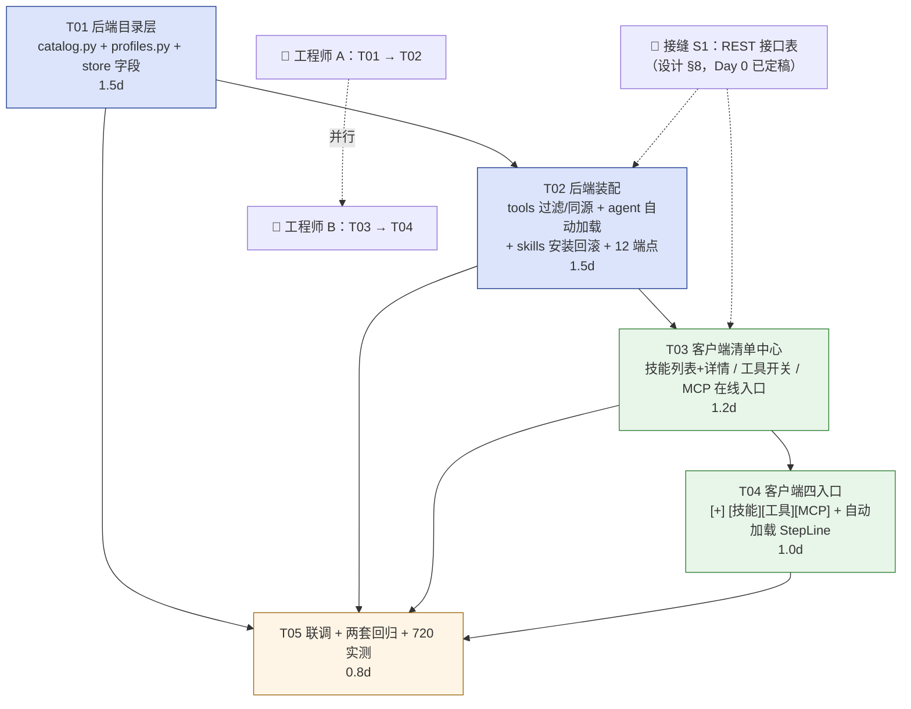

# 智能助理 · 技能 / 工具 / MCP 清单中心（任务分解）

> 版本：v1.0.8 增量 · 架构：高见远（Bob）
> 设计依据：`docs/智能助理-技能工具MCP清单-架构设计.md`（时序图：`docs/智能助理-技能工具MCP清单-时序图.mermaid`）
> **总量：5 个任务包，≈5 人日。P1/P2 全部不在表内（见设计文档 §0.2）。**

---

## 1. 任务总览

| 编号 | 任务名 | 负责模块 | 文件数 | 依赖 | 预估 | 优先级 | 可否跳过 |
|---|---|---|---|---|---|---|---|
| **T01** | 后端目录层：catalog + profiles + 配置字段 | 后端（core） | 4 | 无 | 1.5d | P0 | 否 |
| **T02** | 后端装配：工具裁剪同源 + 自动加载 + 技能安装 + 路由 | 后端（core + routers） | 6 | T01 | 1.5d | P0 | 否 |
| **T03** | 客户端清单中心：技能 Tab 列表+详情 / 工具 Tab 开关 / MCP Tab 在线入口 | 客户端（UI） | 2 | T02 的接口表（§8 已定稿） | 1.2d | P0 | 否 |
| **T04** | 客户端底栏四入口：[+] / [技能] / [工具] / [MCP] + 自动加载 StepLine | 客户端（UI） | 2 | T03 | 1.0d | P0 | 否 |
| **T05** | 联调 + 两套回归 + 既有测试更新 + 720 宽实测 | 全栈 | 3 | T01–T04 | 0.8d | P0 | 否 |

> 合计 ≈ **5.0 人日**（1 人串行）。2 人并行可压到 ≈ **3.3 人日**（见 §3）。

---

## 2. 任务详情

### T01 · 后端目录层（catalog + profiles + 配置字段）

**负责模块**：后端 `core/assistant/`

**文件**
| 文件 | 类型 | 内容 |
|---|---|---|
| `core/assistant/catalog.py` | 新增 | `CatalogError`；`catalog_dir/_proxy/_client/_cache_read/_cache_write/_fresh`；`list_mcp` / `normalize_mcp_server` / `build_mcp_config` / `free_class_of`；`list_repos` / `list_repo_skills` / `fetch_skill_bundle`；`url_to_raw`；`refresh_all`。**v1.0.8 增强**：新增 `fetch_skill_archive`（codeload tarball 整包抽取，支持大体积/二进制）+ 常量 `ARCHIVE_MAX_FILES/ARCHIVE_MAX_BYTES/ARCHIVE_MAX_DOWNLOAD/ARCHIVE_TIMEOUT/CODELOAD_BASE` |
| `core/assistant/profiles.py` | 新增 | `BUILTIN_PROFILES`（3 个）/ `ensure_builtin_profiles` / `match_profiles` |
| `core/assistant/store.py` | 修改 | `_default_config()` 增 `tool_prefs` / `auto_load` / `profiles` / `catalog` / `skill_sources`；`ensure_dirs()` 加 `CATALOG_DIR`；新增模块常量 `CATALOG_DIR` |
| `tests/test_assistant_catalog.py` | 新增 | 单元测试（见验收） |

**依赖**：无（可第一天开工，纯后端、无 UI、无 HTTP 路由依赖）

**验收标准（逐条可测）**
1. `test_default_config_has_new_keys`：`load_config()` 返回的 dict 含 `tool_prefs` / `auto_load` / `profiles` / `catalog` / `skill_sources` 五个 key；且 `save_config({})` 后 json 文件里也有。（防 D7 静默失效）
2. `test_catalog_client_trust_env_false`：`_client(cfg)` 返回的 `httpx.Client` 的 `_transport` 带 `proxy`，且**未**读环境变量。断言方式：`monkeypatch.setenv("HTTP_PROXY", "http://evil:1")` 后 `_proxy(cfg)` 仍优先取 `cfg.catalog.proxy`；`cfg.catalog.proxy=""` 时回落到 `PROXY_DEFAULT="http://127.0.0.1:7897"`。
3. `test_normalize_mcp_server_stdio`：Registry 的 `packages[0].registryType=="npm"` + `runtimeArguments` 按序 → `{transport:"stdio", command:"npx", args:[runtimeArgs…, identifier@version]}`。
4. `test_normalize_mcp_server_http`：`remotes[0].type=="streamable-http"` → `{transport:"http", url:...}`。
5. `test_free_class`：`isRequired=true` → `need_key`；无 required env 且 npm → `zero_config`；既无 packages 也无 remotes → `unknown`（不给安装按钮）。
6. `test_cache_ttl`：`_cache_write` 后用 `_fresh(cache, TTL)` 判定；手工把 `fetched_at` 改老 → `_fresh` 为 False；`_cache_read` 对损坏 json 返回 `{}` 不抛。
7. `test_list_skills_tree_parse`：构造 GitHub tree 响应（含 `a/b/SKILL.md`、`a/b/notes.md`、`a/b/scripts/run.py`）→ `list_repo_skills` 得出 1 个技能、`has_scripts=True`、`files` 只含文本类。
8. `test_fetch_skill_bundle_limits`：构造 25 个文件 / 单文件 3MB → 只取 `SKILL.md` 且 `skipped>0`；`SKILL.md` 200KB+ → 抛 `CatalogError(2022)`（或按设计返回明确错误）。
9. `test_url_to_raw`：
   - `https://raw.githubusercontent.com/o/r/main/skills/pdf/SKILL.md` → 原样
   - `https://github.com/o/r/blob/main/skills/pdf/SKILL.md` → 转 `raw.githubusercontent.com`
   - `https://example.com/a.md` → 抛 `CatalogError(2026)`
10. `test_match_profiles`：
    - `"帮我把下载目录整理一下"` → `file-organize`
    - `"分析一下这个仓库的架构"` → `code-read`
    - 两个都命中（"整理这个项目的代码"）→ 取命中数多者；平局取 `priority` 高者
    - `available_skills` 为空 → 返回 `None`（走 L3）
11. **不联网**：所有用例通过 `monkeypatch` 替换 httpx 或直接调纯函数，测试进程零网络请求。

**可否跳过**：**否**。这是整个 feature 的地基。

---

### T02 · 后端装配（工具裁剪同源 + 自动加载 + 技能安装 + 路由）

**负责模块**：后端 `core/assistant/` + `routers/`

**文件**
| 文件 | 类型 | 内容 |
|---|---|---|
| `core/assistant/tools.py` | 修改 | `__init__` 增 `_filter`；新增 `set_filter` / `active` / `select_schemas`；`to_dict()` 增 `enabled`；`openai_schemas()` 改为走 `select_schemas()` |
| `core/assistant/agent.py` | 修改 | `start_turn` 加 `mounted_skills` 尾参 + profile 匹配 + 同源裁剪 + `start.auto_loaded`；`_build_messages` 改签名收 `schemas`、去掉 `[:80]` |
| `core/assistant/skills.py` | 修改 | `list_skills` 跳 `.` 前缀（A8）；新增 `install_from_github` / `install_from_dir` / `install_from_url` / `_atomic_install` / `prune_backups` |
| `core/assistant/mcp.py` | 修改 | `add_server` 允许在线安装传入 `risk`（缺省 high）；id 冲突已由 catalog 处理，此处只保证幂等 |
| `routers/assistant.py` | 修改 | `chat()` 透传 `mounted_skills`（两条路径）；追加 §8 的 12 个端点 |
| `tests/test_assistant_catalog.py` | 追加 | T02 相关用例（可与 T01 同文件，也可拆 `test_assistant_toolfilter.py`） |

**依赖**：T01

**验收标准**
1. `test_build_messages_matches_schemas`（**A3 核心**）：设置 `tool_prefs.disabled=["shell_run"]`、`max_tools=6` → 断言
   - `registry.select_schemas()` 长度 ≤ 6 且不含 `shell_run`
   - `agent._build_messages(..., schemas)` 生成的 system 文本里**出现的工具名集合** == schema 名集合（用正则抽 `- (\w+)（` 比对），且**不含** `shell_run`
2. `test_select_schemas_priority`：`max_tools=4` → 前 4 个按 §6.2 顺序（fs_list, fs_read, fs_glob, fs_grep）；`fs_write` 被裁；`max_tools=100` → 全量不裁、不报错。
3. `test_list_skills_skips_dot_dirs`（**A8**）：手工 `mkdir SKILLS_DIR/.installing-abc` 并写入 `SKILL.md` + `SKILLS_DIR/.backup-123/SKILL.md` → `list_skills()` **不含**这两项。附带断言 `delete_skill(".backup-123") is False`、`export_zip(".backup-123")` 抛 `SkillError`。
4. `test_install_rollback_on_failure`：`_atomic_install` 注入一个会在写文件阶段抛异常的 monkeypatch → 断言目标 `<slug>` 保持原样（旧内容）、`.installing-*` 已删、`.backup-*` 已回滚。
5. `test_install_overwrite_backup`：先装 A、再装 A 的 v2（`overwrite=True`）→ 旧版在 `.backup-<ts>`、新版生效、`.backup` 份数 ≤ 5。
6. `test_start_turn_mounted_skills_none_is_noop`（**A4 兼容**）：`start_turn(..., mounted_skills=None)` 行为与今天完全一致（用假 provider 断言 system 里**没有**「本轮指定技能」段）。
7. `test_start_turn_mounted_skills_written_to_system`：传 `["repo-digest"]` → system 含「本轮指定技能」，且落库的 `session["messages"][-2]["content"]` == 原始文本（无前缀）。
8. `test_auto_loaded_event`（**start 事件**）：`auto_load=True` + 消息 `"帮我整理目录"` → 用假 provider 抓 `emit` 事件，断言 `events` 中 `type=="start"` 的那条含 `auto_loaded == {"profile":"file-organize","name":"文件整理","skills":["workspace-organizer"],"tools":<int ≤ max_tools>}`；`auto_load=False` → `auto_loaded == {}`。
9. `test_profile_reduces_allow_list`：命中 `web-research` → schema 名集合 ⊆ `{web_fetch, fs_write, skill_run}`（∩ 已启用）；**且 `risk_of("skill_run")` 仍为 `"medium"`**（自动加载不改 risk，红线）。
10. `test_route_catalog_smoke`：**不用 `TestClient`**。两种风格任选（与既有 `tests/test_assistant.py:689` 一致）：
    - `asyncio.run(api.catalog_mcp(q="", cursor="", force=False))` → `code==0`
    - 或 `asyncio.run(_call_asgi(app, "GET", "/api/v1/assistant/catalog/mcp"))` 用 `httpx.AsyncClient(transport=httpx.ASGITransport(app=serve.app))`
    断言：`/state`、`/catalog/*`、`/tools/prefs`、`/profiles` 六条路径都在 `serve.app.routes` 里。
11. `test_tool_prefs_roundtrip`：`PUT /tools/prefs {"disabled":["shell_run"],"max_tools":16}` → `GET` 回读一致；`/state.tools` 里 `shell_run` 的 `enabled == False`。
12. `test_chat_mounted_skills_passthrough`：`chat({"message":"x","mounted_skills":["a"],"stream":False})` → monkeypatch `ass.start_turn` 断言收到 `mounted_skills=["a"]`。

**可否跳过**：**否**。

---

### T03 · 客户端清单中心（ManagerDialog 三 Tab）

**负责模块**：客户端 `client/`

**文件**
| 文件 | 类型 | 内容 |
|---|---|---|
| `client/core/assistant_client.py` | 修改 | `AssistantApi` 增 12 个方法（`catalog_mcp` / `catalog_repos` / `catalog_repo_skills` / `catalog_install_skill` / `catalog_install_mcp` / `catalog_refresh` / `catalog_from_dir` / `catalog_from_url` / `tool_prefs` / `save_tool_prefs` / `profiles` / `save_profiles`） |
| `client/ui/pages/assistant_page.py` | 修改 | `_build_skills_tab` 改 `QSplitter`（左列表+工具条 / 右详情 `QPlainTextEdit`）；`_build_tools_tab` 改行内 `QCheckBox`；`_build_mcp_tab` 加「从在线清单安装 MCP…」；`_fill_tools` 填开关态；`ManagerDialog.setMinimumSize(700,520)` + `resize` 到主窗口 86%×84%；新增在线区加载/搜索/筛选/安装确认框 |

**依赖**：T02 的**接口表**（设计文档 §8 已定稿 —— **不必等 T02 代码完成**，可按接口表先用假数据联调）

**验收标准**
1. **技能 Tab 结构**：`ManagerDialog` 技能页含 `QSplitter`，左右比例默认 62/38（`setSizes`）；左为 `QListWidget`（**属性名保持 `_skill_list`，勿改名**），条目两行文本（`名称 · vX.Y` + `\n` + 描述），`setWordWrap(False)`；右为只读 `QPlainTextEdit`（`_skill_detail`）。
2. **680/720 实测算得下**（**A7**）：断言 `dlg.minimumWidth() <= 700`；`dlg.resize(720*0.86, 680*0.84)` 后技能列表 `viewport().height() >= 5 * 40`（≥5 行）。
3. **搜索/来源/排序三件套**：`_skill_search` 输入子串 → 列表实时过滤（匹配 name/description）；来源下拉（全部/内置/本地/在线）按 `builtin` + `skill_sources` 判定；排序（star 降序 / 更新时间）。测试用 monkeypatch 塞 3 条假数据断言过滤结果。
4. **工具 Tab 开关**：每条有 `QCheckBox`；取消勾选 → `PUT /tools/prefs` 被调用（记录在 fake api）；顶部常驻文案 `当前下发 N / 上限 M`；**关闭 `skill_run`/`skill_list` 时弹二次确认**（断言 `QMessageBox.question` 被调用）。
5. **MCP Tab 在线入口**：按钮行含「从在线清单安装 MCP…」；点击 → 切到在线区（或 `open_manager("mcp")` 聚焦在线列表）。
6. **在线区离线退化**：fake api 抛 `RuntimeError("无法连接在线目录…")` → 顶部提示条可见、列表区保留上次缓存、**无空白页**；缓存也没有 → 空态文案含「先用『导入 zip / 本地文件夹』添加技能」。
7. **安装确认框内容**：技能确认框文案含「来源」「⭐」「文件数」「脚本警示」「风险=medium」；MCP 确认框含「传输」「是否需密钥」「风险=high」。
8. **不引入原生对话框**：本任务**不新增任何文件选择**（交给 T04）；`test_no_native_file_dialog_static_calls` 必须仍绿。

**可否跳过**：**否**（P0-1）。但**右侧详情面板可降级为纯文本**（已降级，不做 Markdown 渲染）。

---

### T04 · 客户端底栏四入口 + 自动加载 StepLine

**负责模块**：客户端 UI

**文件**
| 文件 | 类型 | 内容 |
|---|---|---|
| `client/ui/pages/assistant_page.py` | 修改 | 底栏加 `_tool_btn` / `_mcp_btn`；`_build_attach_menu` 4 段改造；`_build_skill_menu` 空态改 3 条安装入口 + 自动加载开关行；新增 `_build_tool_menu` / `_build_mcp_menu` / `_show_tool_menu` / `_show_mcp_menu`；`_pick_file` 加 `directory` 参数；新增 `_import_skill_from_dir` / `_install_skill_from_url` / `_paste_mcp_json`；`_send_with_session` 改传 `mounted_skills`；`_on_event` 加 `start` 分支；新增 `_add_step_with_action` / `_disable_auto_load`；宽度压缩规则 ①②③⑤（§5.4） |
| `client/ui/pages/assistant_page.py` | 修改 | `_refresh_ws_btn` 截断 12 → 4 字；`_refresh_model_btn` 短名 8 字；底栏 `setSpacing(2)` |
| `client/ui_tests/test_assistant_page.py` | 修改 | 更新 2 个必然失败的既有断言（§10）+ 新增用例 |

**依赖**：T03（`open_manager(key)` 的 focus 语义）

**验收标准**
1. **三按钮始终可见且带文字**（**否决 1**）：`p._tool_btn.text() == "工具"`、`p._mcp_btn.text() == "MCP"`、`p._skill_btn.text() == "技能"`；三者 objectName 都是 `BarChip`；**断言不存在任何 `setVisible(False)` 的宽度联动逻辑**（测试里把页面 `resize(720, 680)` 后三者 `isVisibleTo(p)` 仍为 True）。
2. **宽度预算落地**：`resize(720, 680)` 后 `bar` 的 `sizeHint().width() <= 504`（右侧对话列可用宽）——若超，说明 ①②③ 某条没生效，测试即红。
3. **`[+]` 菜单**：含「添加附件…」「从本地文件夹导入技能…」「导入技能 zip…」「粘贴 URL 安装技能…」「粘贴 JSON 添加 MCP…」「刷新在线目录」「能力清单（技能 / 工具 / MCP）…」；分 4 段（`separator` 数 == 4）。**同步更新既有 `test_attach_plus_menu_has_five_entries`**（改为断言首项 + 关键项包含 + 以「审计」结尾）。
4. **`[技能]` 空态可装**：`_state["skills"]=[]` → 菜单含 3 条可点入口（`从在线清单安装…` / `从本地文件夹导入…` / `粘贴 URL 安装…`），**全部 `isEnabled()`**（不能是禁用文案）。
5. **`[技能]` 自动加载开关**：菜单含一行 `自动加载：开 / 关`，点击 → `PUT /settings {"auto_load": False}` 被调用。
6. **`[工具]` 菜单**：首行 `当前下发 N / 上限 M`（禁用）；逐工具 checkable，`shell_run` 关闭时弹二次确认；含「工具清单与开关…」与「⟳ 重连已启用 MCP」。
7. **`[MCP]` 菜单**：首行 `已配置 X 台 · 已连接 Y 台`；含「从在线清单安装 MCP…」「＋ 手动添加（stdio / http）…」「管理 MCP 服务器…」。
8. **「从本地文件夹导入技能」不用原生框**（**D5 硬约束**）：
   - `_import_skill_from_dir()` 调用 `_pick_file(..., directory=True)`；用 `_FakeFD` 断言 `opts[DontUseNativeDialog] is True`、`mode == FileMode.Directory`、标签 `Accept == "选择此文件夹"`
   - `test_no_native_file_dialog_static_calls`（`:1194`）**必须仍绿** —— 源码里不得出现 `getExistingDirectory(`
9. **`mounted_skills` payload**：`_send_with_session` 后 `payload["message"] == 原文本`、`payload["mounted_skills"] == ["repo-digest"]`。**同步更新既有 `test_multi_skill_prefix_injected_in_payload`**（`:392`）。
10. **自动加载 StepLine**：`p._on_event({"type":"start","auto_loaded":{"profile":"file-organize","name":"文件整理","skills":["workspace-organizer"],"tools":7}})` → 消息区末尾出现一行文本含「已自动加载：文件整理」「workspace-organizer」「7 个」+ 一个按钮「关闭自动加载」；**同一 sid + 同 profile 第二次事件不再新增行**（`_msg_layout.count()` 不变）。
11. **点「关闭自动加载」**：`PUT /settings {"auto_load": False}` 被调用，状态栏含「已关闭自动加载」。
12. **`StepLine` 未被改造**：`assistant_cards.StepLine.__init__` 签名仍为 `(text, parent=None, error=False)`（`inspect.signature` 断言）——防止顺手改坏 5 处既有调用。

**可否跳过**：**否**（P0-4 / P0-6，用户原话的两条核心需求都在这里）。

---

### T05 · 联调 + 两套回归 + 既有测试更新 + 720 宽实测

**负责模块**：全栈

**文件**
| 文件 | 类型 | 内容 |
|---|---|---|
| `tests/test_assistant_catalog.py` | 追加 | 端到端：`install_from_github` 全链路（fake httpx → 落盘 → `list_skills` 出现 → `/state.skills` +1） |
| `client/ui_tests/test_assistant_page.py` | 修改/追加 | 清单中心 720 宽快照用例；四入口全量用例；自动加载用例 |
| `docs/智能助理-技能工具MCP清单-验收记录.md` | 新增 | 实机 200% 缩放截图结论 + 两套测试 passed 计数 |

**依赖**：T01、T02、T03、T04

**验收标准**
1. **后端测试全绿**：`cd E:/llm-service && python -m pytest tests/` → 0 failed（新增用例 + 既有 `test_assistant.py` / `test_assistant_queue.py` / `test_gateway.py` 全绿）。
2. **客户端测试全绿**：`cd E:/llm-service/client && python -m pytest ui_tests/` → **按 passed 计数判定**（退出码 127 = 既有 Qt 析构崩溃，非本 feature 引入）。
3. **两套分开跑**，不得在同一次 pytest 调用里同时跑（前后端同名 `core` 包）。
4. **720 逻辑宽实机验证**（A7）：`QT_QPA_PLATFORM=offscreen` 下 `resize(720, 680)` 截图；断言底栏三按钮 + `[+]` + `工作区` + `⊘` 全部可见、无省略号截断到无法辨认；清单中心 `resize` 后技能列表 ≥ 5 行。
5. **既有断言更新清单**（必须显式改，不许删）：
   - `test_attach_plus_menu_has_five_entries`（`:407`）
   - `test_multi_skill_prefix_injected_in_payload`（`:392`）
   - `test_dark_theme` 若新增 objectName → 补进 `test_light_theme_covers_bottom_bar_and_nav`（`:1362`）
6. **代理实机验证**：后端在**有代理**机器上 `GET /catalog/mcp?force=1` 返回 `code==0`（证明 `trust_env=False` + `proxy=127.0.0.1:7897` 生效）；把 `cfg.catalog.proxy` 改成错误端口 → 返回 `code==2020` 且响应**不超 6s**。

**可否跳过**：**否**。

---

## 3. 并行建议（2 人）

```
Day 0.5 ────────────────────────────────────────────────────────────────
  工程师 A                    │  工程师 B
  T01 catalog.py               │  （等 T02 接口表，§8 已定稿 → 立刻可开工）
  T01 profiles.py              │  T03 客户端清单中心「骨架 + 假数据」
  T01 store.py 字段             │    · ManagerDialog 700×520 + QSplitter
                              │    · 技能 Tab 两行列表 + 搜索/来源/排序（假数据）
Day 1.5 ──────────────────────┼────────────────────────────────────────
  T02 tools.py 过滤             │  T03 接真实接口（AssistantApi 12 方法）
  T02 agent.py 同源 + auto      │    · 在线区 + 提示条 + 安装确认框
  T02 skills.py 安装/回滚        │  T03 工具 Tab 开关 + MCP Tab 在线入口
Day 2.5 ──────────────────────┼────────────────────────────────────────
  T02 routers 12 端点           │  T04 底栏三按钮 + 宽度压缩 ①②③⑤
  T01/T02 单测补齐               │  T04 四入口菜单 + _pick_file(directory)
                              │  T04 mounted_skills + start 分支 + StepLine
Day 3.3 ──────────────────────┴────────────────────────────────────────
  合流 T05：两套回归 + 720 实测 + 既有断言更新（两人一起，约 0.8d）
```

**关键接缝（必须提前对齐，否则返工）**
| 接缝 | 对齐物 | 时机 |
|---|---|---|
| S1 | **REST 接口表**（设计 §8）| Day 0 已定稿，B 直接按表写 fake api |
| S2 | `ToolRegistry.list()` 新增 `enabled` 字段名 | T02 提 PR 前在群里确认（B 的 `_fill_tools` 依赖此字段名）|
| S3 | `start.auto_loaded` 的**字段名**：`profile` / `name` / `skills` / `tools` | 同上 |
| S4 | `_add_step_with_action` 的按钮 objectName（用 `MiniBtn`）| T04 内自洽，不跨人 |
| S5 | `open_manager` 的 `focus` 值集：`"skills"` / `"tools"` / `"mcp"` / `"audit"` | T03 定义，T04 使用 |
| S6 | `AssistantApi` 方法名与参数顺序 | 按设计 §3.2 表格，B 先写、A 照抄 |

**串行风险点（不要并行）**：`client/ui/pages/assistant_page.py` 是**单文件**，T03 与 T04 都由 B 做，**不要拆给两人**（同一个 2949 行文件的合并冲突代价 > 并行收益）。

---

## 4. 共享知识（跨切面约定）

1. **返回约定**：所有 REST 一律 `{code, message, data}`（`routers/assistant.py:77` `ok()` / `:81` `fail()`）。业务错误 **HTTP 200 + `fail()`**；客户端 `AssistantApi._unwrap`（`assistant_client.py:39`）遇 `code != 0` 抛 `RuntimeError(message)`，UI 只展示 `message`。
2. **代理**：catalog 的 httpx **一律** `trust_env=False` + 显式 `proxy=`。默认 `http://127.0.0.1:7897`。**绝不**依赖 `HTTP_PROXY` 环境变量（`core/pool.py:182`、`routers/gateway.py:464` 是先例）。
3. **原生对话框禁令**：客户端任何文件/目录选择只能走 `_pick_file()` / `_choose_workspace()`。`QFileDialog.getOpenFileName` / `getSaveFileName` / `getExistingDirectory` **源码里不得出现**（`test_assistant_page.py:1194` 会扫）。
4. **测试**：
   - 后端：`cd E:/llm-service && python -m pytest tests/`
   - 客户端：`cd E:/llm-service/client && python -m pytest ui_tests/`
   - **分开跑**（前后端同名 `core` 包）。客户端退出码 127 是既有 Qt 析构崩溃，按 passed 计数判定。
   - 后端路由测试**禁用 `TestClient`**（httpx 0.28 + starlette 0.35 不兼容）。用 `asyncio.run(api.xxx())` 或 `httpx.AsyncClient(transport=httpx.ASGITransport(app=serve.app))`。
5. **配置字段**：任何新 `config.json` key **必须**先进 `store._default_config()`（`store.py:101` 的 `if k in cfg` 过滤）。
6. **审计**：安装/刷新/开关变更都写 `store.audit(event, **fields)`；event 名见 PRD §8.3（`skill_installed_online` / `mcp_installed_online` / `catalog_refreshed` / `catalog_install_failed` / `tools_prefs_updated` / `auto_load_applied`）。
7. **安全红线**：在线安装**永不执行**下载到的脚本，只落文件；`slug` / `dir` 不得含 `..`、盘符、绝对路径；MCP 在线安装的 `command` 白名单 `npx/uvx/python/node/docker`。
8. **审批零改动**：`approval.py` **不动**。自动加载只收窄工具白名单，**不改任何 risk**。
9. **时间戳**：审计用 `time.time()`（既有 `store.audit` 自填）；展示用 `HH:MM` / `MM-dd HH:mm`（客户端 `hhmm` 与 `time.strftime` 现状）。
10. **UI 命名**：`_skill_list` / `_tool_list` / `_mcp_list` **保持原名**（既有测试 `:609` 依赖）。新增控件用新名并加 `#objectName` QSS 覆盖（补进 `core/theme.py` 的浅色 + 深色两段）。

---

## 5. 任务依赖图



---

## 6. 工作量对账（vs PRD 9 人日）

| PRD 切分 | PRD 估 | 本方案归入 | 说明 |
|---|---|---|---|
| T01 catalog | 1.5d | T01 | 一致 |
| T02 路由 | 0.5d | T02（合并） | 路由很薄（12 个函数 ≈ 200 行），合并进后端装配 |
| T03 tools/agent 裁剪 | 0.5d | T02（合并） | 同人同文件，合并省交接 |
| T04 profiles + auto_load | 0.5d | T01（profiles.py）+ T02（agent 装配） | 纯关键词逻辑 ≈ 90 行，并入 T01 更省 |
| T05 skills 安装/回滚 | 1.0d | T02（合并） | 与 A8 同文件，合并省冲突 |
| T06 ManagerDialog 技能 Tab | 1.5d | T03 | 一致 |
| T07 四入口菜单 + 工具开关 | 1.0d | T04 | 一致 |
| T08 在线区块 | 1.0d | T03 | 一致 |
| T09 自动加载 StepLine | 0.5d | T04 | 一致 |
| T10 单测 + 回归 | 1.0d | T01/T02/T03/T04 内联 + T05 0.8d | 单测跟着实现走（不集中到最后），T05 只做联调 |
| **PRD 合计 9d** | | **5.0d** | **降 4d 的来源：①后端 6 个子任务合并成 2 个（省交接与重复读码 ≈1d）；②P1/P2 全砍（≈1.5d）；③详情面板降级为纯文本（≈0.5d）；④不做进度条/批量装/自定义 profile（≈1d）** |
