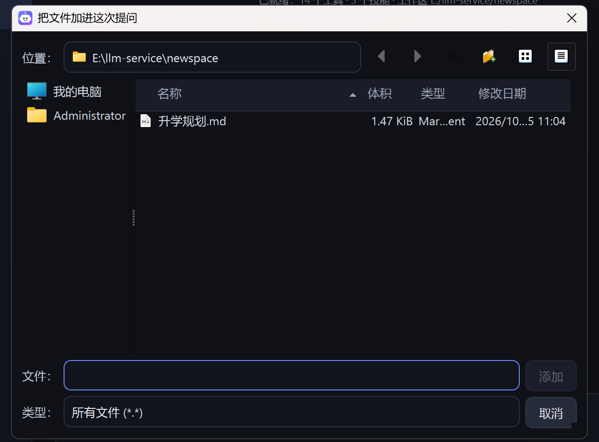

# 智能助理（1.0.8）

> 左菜单第一个模块「智能助理」。目标：在 llmBuddy 里复刻 WorkBuddy 那套体验——
> 能操作本机文件、调用 MCP、高危动作要审批、技能可导入导出、模型可切本地/硅基流动/任意第三方。

## 1. 职责划分

| 层 | 由谁负责 | 落地代码 |
|---|---|---|
| 网关 / 工具 / 权限 / UI | 助手内核（OpenClaw 同构，内置实现） | `core/assistant/{agent,tools,approval,mcp}.py`、`client/ui/pages/assistant_page.py` |
| 复杂子任务编排 | **LangGraph**，塞在技能内部 | `core/assistant/orchestrator.py` |
| 模型推理 | llmBuddy 网关 / 硅基流动 / 任意 OpenAI 兼容端点 | `core/assistant/providers.py` |

LangGraph 只在「技能执行」时介入：技能正文（SKILL.md）被拆成
`plan → act → review ↺ / finish` 四个阶段，普通对话仍走轻量的 Agent 循环，
不为一句话的问答付建图开销。

## 2. 数据位置

全部在用户目录，安装目录保持只读：

```
%LOCALAPPDATA%\llmBuddy\assistant\
    config.json                 提供商 / 审批策略 / 工作区 / MCP 服务器
    skills\<slug>\SKILL.md      技能包（与 OpenClaw / Claude Skill 同构，可直接互换）
    sessions\<id>.json          会话记录
    audit\audit-YYYYMMDD.jsonl  审计（谁在何时批准了什么）
    workspace\                  默认工作区（.trash 为删除回收站）
```

## 3. 工具与风险等级

| 工具 | 风险 | 说明 |
|---|---|---|
| `fs_list` `fs_read` `fs_glob` `fs_grep` `fs_info` | low | 只读，自动执行 |
| `fs_write` `fs_edit` `fs_mkdir` `fs_move` | medium | 写入；**越出工作区自动升为 high** |
| `fs_delete` | high | 删除，移入 `workspace\.trash\<时间戳>`，可恢复 |
| `shell_run` | high | 执行命令；内置黑名单（format/rm -rf / 等）直接拒绝 |
| `web_fetch` | medium | 抓网页（走系统代理），外发动作 |
| `skill_list` `skill_run` | low / medium | 运行技能（内部由 LangGraph 编排） |
| `mcp__<server>__<tool>` | 服务器配置（默认 medium） | MCP 工具，连接后自动注册 |

沙箱规则：相对路径以工作区为根；绝对路径允许但越界会升级风险，交由审批拦截。

## 4. 高危动作审批

三种策略（页面右上角切换，存在 `config.json`）：

- `readonly_auto`（默认）：low 直接执行；medium/high 弹审批卡片
- `ask_all`：任何工具调用都要确认（最严）
- `yolo`：全部放行，只留审计（本机私有沙箱用）

审批卡片三个按钮：**允许** / **本会话允许同类** / **拒绝**。
被拒绝后模型会收到「用户未批准，请换方案」，不会死循环重试同一动作。
等待超时（默认 300s）按拒绝处理，并写审计。

## 5. 技能（SKILL.md）

格式与 OpenClaw 一致，因此可以直接导入生态里的技能包：

```markdown
---
name: repo-digest
description: 扫描代码库生成结构化摘要
tools: [fs_glob, fs_read, fs_grep]
version: 1.0.0
---
# 目标
...
# 执行要求
1. ...
```

- `tools` 是白名单，技能只能调这些工具（MCP 工具始终放行）
- 内置三个示例技能：`workspace-organizer`、`repo-digest`、`web-brief`
- 导入：zip（根目录或一级子目录含 SKILL.md 即可），支持一包多技能
- 导出：整目录打包 zip，可直接分享给别人或别的助手
- 页面「技能」标签页支持新建 / 编辑 / 导入 / 导出 / 删除

## 6. MCP

页面「MCP」标签页添加，两种传输：

```json
// stdio（本机子进程，npx / uvx / 任意可执行文件）
{"id": "filesystem", "name": "文件系统", "transport": "stdio",
 "command": "npx", "args": ["-y", "@modelcontextprotocol/server-filesystem", "E:\\work"],
 "risk": "medium", "enabled": true}

// http（Streamable HTTP）
{"id": "remote", "name": "远程服务", "transport": "http",
 "url": "http://127.0.0.1:3000/mcp", "risk": "high"}
```

连接后自动 `tools/list` 并把每个工具注册成 `mcp__<id>__<tool>`，
模型可像内置工具一样调用；断开或删除时同步注销。

## 7. 模型接入

| 提供商 | 说明 |
|---|---|
| 本地模型 | 走 llmBuddy 网关 `127.0.0.1:8000/v1`，复用「模型库」里已加载的模型；模型名留空=自动取第一个已加载 |
| 硅基流动 | `https://api.siliconflow.cn/v1`，Key 可自动复用对话页已存的 `chat/cloud_api_key` |
| 自定义 | 任意 OpenAI 兼容端点（DeepSeek / 通义 / vLLM / Ollama / OpenRouter…） |

密钥只存在本机 `assistant/config.json`，`/state` 接口只返回 `has_key` 不回传密钥。
**思考模型**：请求本机网关时带 `X-LLM-Raw-Reasoning: 1`，网关不再把
`reasoning_content` 合并进 `content`，助理把思考折叠进「思考过程」卡片，
正文单独渲染——避免把推理过程当答案（qwen3 系列关不掉思考，只能这样分流）。

## 8. API（`/api/v1/assistant/*`）

| 方法 | 路径 | 用途 |
|---|---|---|
| GET | `/state` | 运行态快照（提供商/工具/技能/MCP/策略/会话） |
| POST | `/chat` | 一轮对话，SSE 事件流（`stream=false` 返回 JSON） |
| POST | `/stop` | 中止当前轮次 |
| GET/POST | `/approvals` `/approvals/{id}` | 待审批列表 / 批准或拒绝 |
| GET/POST/DELETE | `/skills` `/skills/{slug}` | 技能增删查 |
| POST | `/skills/import` | 导入 zip（base64） |
| GET | `/skills/{slug}/export` | 导出 zip |
| GET/POST/DELETE | `/mcp` `/mcp/{id}/connect` `/mcp/{id}/disconnect` | MCP 管理 |
| GET/PUT | `/settings` | 助手配置（providers 按 id 合并，不会抹掉未提交的 Key） |
| GET | `/audit` | 审计记录 |
| GET/POST/DELETE | `/sessions` `/sessions/{id}` | 会话 |

SSE 事件类型：`session` `start` `model` `delta` `reasoning` `replace`
`tool_call` `tool_result` `approval_request` `approval_result` `skill_step`
`title` `done` `error` `stopped` `end`。

## 9. LangGraph 编排细节

`core/assistant/orchestrator.py`

```
START → plan → act → review ─┬→ act（未完成且未超步数）
                             └→ finish → END
```

- `plan`：把用户任务拆成 3~6 步（JSON 数组，解析失败按行拆）
- `act`：逐步执行，每步最多 3 轮工具调用，工具调用同样走审批
- `review`：判定 DONE 或 `NEXT: 补充步骤`，可动态追加步骤（上限 6 步）
- `finish`：汇总成给人看的 Markdown

降级：`import langgraph` 失败时自动改用等价的顺序循环（`engine=sequential`），
打包环境缺依赖也不会 500。

## 10. 验证

```bash
# 后端（含助理内核 16 条）
cd E:/llm-service && python -m pytest tests/ -q

# 客户端 UI（含助理页面 7 条）
cd E:/llm-service/client && python -m pytest ui_tests/ -q
```

实测（本机 qwen3-4b，CPU）：一轮「列出工作区文件」=
`fs_list` 工具调用 → 结果回填 → 中文总结，思考与正文正确分流。

## 11. 已知限制

- 4B 级本地模型多轮工具调用较慢（每轮 30-60s），复杂技能建议用硅基流动或更大模型
- 思考模型（qwen3）无法关闭思考，`max_tokens` 太小会导致只思考不输出，
  助理会明确报「模型没有返回正文」而不是显示空回复
- MCP stdio 服务器首次连接依赖 npx/uvx 联网拉包，可能较慢；失败会显示 stderr 尾部
- 审批只做「本会话记住同类工具」，不做持久化白名单（重启后重新确认，安全优先）

## 12. 界面布局（1.0.8 修订，照 WorkBuddy 对话框形态重排）

两处结构调整（对应界面批注）：

1. **右侧 tab 面板整块取消**：会话 / 技能 / 工具 / MCP / 审计 改为左栏「智能助理」
   一级项下的**二级栏目直接显示**；
2. **输入框上方的胶囊排下沉**：按 WorkBuddy 底栏形态融成输入框底部一行工具条，
   模型来源与模型名合并成一个下拉，密钥配置收进该菜单。

```
左栏                          右栏
┌──────────────┐  ┌ 智能助理                              [管理] ┐
│ llmBuddy     │  ├ 对话流（气泡 / 思考折叠 / 工具卡 / 审批卡）    ┤
│ v1.0.8       │  │                                               │
│ ▸ 智能助理   │  │                          就绪                 │
│   任务 (7) + │  ├ ╭ Composer ─────────────────────────────────╮ ┤
│   📌 做PPT   │  │ │ 今天帮你做些什么？                        │ │
│   看一下天气 │  │ │                                            │ │
│   空间 (3)   │  │ │ [+] [workspace] [⊘ 只读自动] [技能]        │ │
│   ▾ 📁 llm…  │  │ │              ◐            [qwen3-4b ▾] [↑] │ │
│      📌 做PPT│  ├ ╰────────────────────────────────────────────╯ ┤
│   技能 · 3   │  │  内容由 AI 生成，请核实重要信息                │
│   工具 · 14  │  └───────────────────────────────────────────────┘
│   MCP · 1 / 审计
│ 控制台 / 模型库 / 对话 / API / 设置
└──────────────┘
```

对话区与输入框都在一条最宽 940px 的居中列里，窗口拉宽也不会把一行字拖成超长行。

### 12.1 底栏各板块与 WorkBuddy 的对应关系

WorkBuddy 底栏是一条「动作 → 上下文 → 状态 → 模型 → 发送」的流，llmBuddy 逐位对齐；
本机确实没有的能力（提示词优化、语音输入）不做假按钮。

| WorkBuddy | llmBuddy | 行为 |
|---|---|---|
| `+` 添加附件 | `+`（`#BarBtn`） | 选本机文件，插入 `@路径` 作为上下文 |
| 分支 `master` | 工作区（`#BarChip`） | 文件工具的根目录；按钮直接显示目录名，tooltip 给全路径，点击切换 |
| `⊘` 权限 | 审批策略（`#BarChip`） | 只读自动 / 全部确认 / 全部放行，点开是单选菜单，选中即写后端 |
| `× 软件开发团队` | `技能` chip（`#BarChip[active]`） | 挂载后变 `✕ 技能名`；之后每条消息自动带「用 xx 技能」前缀，输入框本身不被改写；再点可换或清除 |
| 加载环 | `◐` 旋转（`#BusyDot`） | 运行中每 120ms 转一格，与 `■` 停止按钮配套 |
| `✨` 增强 | —— | 本机没有提示词优化能力，不做假按钮 |
| 模型下拉 | 模型（`#ModelChip`） | 一个菜单里给全：模型来源子菜单 / 当前来源的模型（打勾）/ 刷新列表 / 配置密钥与端点 |
| `🎤` 语音 | —— | 本机暂无语音输入，不做假按钮 |
| `↑` 发送 | `#SendBtn` | 实心圆按钮；流式期间原地变 `■`（`#StopBtn`）停止 |

### 12.2 左栏「任务 / 空间」两区（照 WorkBuddy 的任务与空间）

原来的「会话」列表改名并升级成 WorkBuddy 的结构：**任务 = 一次对话，空间 = 任务所属的
工作区目录**。后端数据格式没变（还是 `sessions/*.json`），只是多了三个字段：
`workspace`（所属空间）、`pinned`（置顶）、`archived`（归档），老数据自动兼容。

| 元素 | 行为 |
|---|---|
| 任务 (N) `+` | 跨空间的最近任务，置顶的排最前（`📌` 前缀）；N 只算有消息的任务；点 `+` 新建任务（当前任务本来就是空的会直接复用，不重复建） |
| 任务条目 | 单击即切到该任务；**打开时工作区自动跟到它所属的空间**，避免「在 A 空间的任务里让助理改文件，结果改到 B 目录」 |
| 空间 (M) | 任务按所属工作区目录分组，`▸` 折叠 / `▾` 展开（手风琴，同时只展开一个，左栏放不下） |
| 空间条目 | 显示目录名 + 该空间任务数；目录不存在（移动盘拔了）显示 `⚠`，任务不会丢 |
| 「其余 N 个空间…」 | 超出 4 个空间时的入口，点开管理面板看全部 |
| 技能 · N / 工具 · N / MCP · N / 审计 | 打开管理面板并定位到对应 tab；N 是实时数量 |

任务右键菜单（对齐 WorkBuddy，不可用的能力换成等价物）：

| WorkBuddy | llmBuddy | 说明 |
|---|---|---|
| 置顶 | 置顶 / 取消置顶 | 置顶后永不参与「最近活动」排序的沉底，且不改 `updated_at` |
| 重命名 | 重命名… | 弹 `QInputDialog`（Qt 自绘，不碰原生对话框） |
| 分享任务 | 导出为 Markdown… | 本机产品没有分享服务，导出成 md 交付出去 |
| 在独立窗口中打开 | —— | 单窗口应用，不适用 |
| 打开文件夹 | 打开所在空间 | 用资源管理器打开任务所属工作区目录 |
| 批量操作 | —— | 管理面板里有多选外的「清理空任务」 |
| 归档 | 归档 / 取消归档 | 归档后默认不出现在左栏与列表，`?include_archived=1` 才给 |
| 删除任务 | 删除任务 | 二次确认，弹窗挂在当前可见窗口（管理面板打开时就挂面板） |

空间右键菜单：在此空间新建任务 / 展开收起 / 在资源管理器中打开。

- 两区都在一个自动隐藏滚动条的容器里：窗口矮的时候内部滚动，不会把下面的
  「控制台 / 模型库 / 对话 / API / 设置」挤没。条数上限：任务 4 条、空间 4 个、
  每个展开的空间 5 条，其余走管理面板。
- 左栏只列**有内容**的任务：0 条消息的空任务（反复点「+」、来回切页攒出来的）
  只留在管理面板里，可以一键「清理空任务」。否则「任务」区那四个位置会被一串
  「新任务」占满，真正在聊的任务反而看不见；当前任务无论空不空都保留。
- 高度是按行数算的（`rows * 26 + 4`），不信 `QScrollArea.sizeHint()`：滚动区
  在 `widgetResizable=True` 下的 `sizeHint` 会偏小，布局按它分配高度会把
  「空间」整段挤出视口（实测过）。
- **高 DPI 下的窄高左栏**：本机是 200% 缩放，1440px 的屏幕折算成逻辑高度只有
  720，窗口贴着最小高 680 时左栏只剩 680px。这时「技能 / 工具 / MCP / 审计」四个
  二级入口如果按 QSS 的 `min-height` 撑到 40px 一个（4 个 160px），「空间」那一行
  正好被挤到视口外——打包后看起来像「空间不见了」，源码跑 900 高的窗口反而正常。
  现在四个入口用 `setFixedHeight(NAV_ENTRY_H=30)` 定死，省下的 40px 刚好够。
- 排查开关：设 `LLM_NAV_DBG=1` 启动，左栏每次重建会把各层高度与每行几何追加到
  `%LOCALAPPDATA%\llmBuddy\logs\nav_dbg.log`（判「谁把滚动区压小了」用）。
- 二级栏目只在「智能助理」页展开，切到控制台等其它页自动收起。
- 管理面板（`ManagerDialog`）是 5 个 tab：任务（完整列表 + 所属空间 + 删除）/ 技能
  （新建、编辑、导入导出 zip）/ 工具（风险标注）/ MCP（增删、连接断开）/ 审计（最新记录）。
- 深色与浅色主题各有对应覆盖（`styles.qss` + `core/theme.py`）：`#BarBtn`、`#BarChip`、
  `#ModelChip`、`#BusyDot`、`#NavGroupTitle`、`#NavTaskItem`、`#NavSpaceItem`、`#NavEmpty`。

接口（`/api/v1/assistant`）：

| 方法 | 路径 | 说明 |
|---|---|---|
| GET | `/sessions?include_archived=1` | 任务列表（置顶优先，其余按最近活动） |
| POST | `/sessions` `{title?, workspace?}` | 新建任务，`workspace` 为空归当前工作区 |
| PATCH | `/sessions/{sid}` `{title?/workspace?/pinned?/archived?}` | 重命名 / 移动 / 置顶 / 归档 |
| GET | `/spaces` | 任务按空间分组（含 `exists`：目录是否还在） |
| DELETE | `/sessions/{sid}` | 删除任务 |

截图：`images/assistant-nav-tasks-dark.png`、`images/assistant-nav-tasks-light.png`。


## 13. 工作区与「闪退」排查（1.0.8 修订）

### 13.1 工作区存在两处，且先写本机

| 位置 | 字段 | 作用 |
|---|---|---|
| `%LOCALAPPDATA%\llmBuddy\config.json` | `assistant_workspace` | **本机记忆**，点选目录的瞬间就落盘 |
| `%LOCALAPPDATA%\llmBuddy\assistant\config.json` | `workspace` | 后端实际生效值（文件工具沙箱根） |

顺序刻意是「先本机、后后端」：用户曾反馈「选工作区就闪退，重开也没接上」，
那种情况下后端的 `PUT /settings` 根本没发出去，只写后端等于什么都没保存。

启动/切回页面时（`_apply_state`）：

1. 后端回报的工作区优先；
2. 后端为空或与本机记忆不一致、且本机记录目录仍存在 → 用本机记忆显示，
   并**补同步一次**给后端（`_ws_synced` 保证每个页面实例只发一次，不会刷成循环）；
3. 后端有值、本机记录不同 → 以**后端为准**，回写本机记录保持一致。

### 13.2 原生文件对话框：本机冻结包必崩（已确证）

**根因（1.0.8 定位）**：系统原生文件/目录对话框在这个冻结包里一调用就以

```
Windows fatal exception: code 0x8001010e            ← RPC_E_WRONG_THREAD
  File "ui\pages\assistant_page.py", line 346 in _attach_file
  File "main.py", line 290 in main
```

直接杀掉进程（COM 套间错误：调用了被另一套间封送的接口）。它**不是** Python 异常，
所以 `crash.log` 里原本什么都没有、`startup.log` 也停在 `entering app.exec()`，
用户侧的唯一观感就是「点一下就闪退」。开发态（`python main.py`）同样调用是正常的，
只有冻结包复现——这也是它长期没被定位的原因。

修复方式：页面内**所有**文件/目录选择统一走自绘对话框
（`QFileDialog.Option.DontUseNativeDialog`），并集中到两个入口：

| 入口 | 覆盖的场景 |
|---|---|
| `_pick_file(title, start, filter, save, default_name, accept_text)` | `+` 添加附件、导入技能包 zip、导出技能包 zip |
| `_choose_workspace()` | 底栏「工作区」切换目录 |

标签（位置 / 文件 / 文件名 / 类型 / 选择 / 取消）都在代码里写死中文，不依赖
Qt 翻译文件是否随包；`main.py` 另外调 `install_translations()` 加载
`qtbase_zh_CN.qm`（包内已有），顺带覆盖其它 Qt 标准控件的文案。

回归保护：`test_no_native_file_dialog_static_calls` 直接扫源码，禁止再出现
`getOpenFileName(` / `getSaveFileName(` / `getExistingDirectory(`。

修复后的「+ 添加附件」对话框（Qt 自绘、全中文、深浅色一致）：



### 13.3 选到不可用目录不会把后端搞挂

- 客户端：选中后先 `os.path.isdir` 校验，坏路径直接提示、不同步；
- 后端 `store.load_config()`：`os.makedirs(workspace)` 失败不再抛异常（此前会
  让 `/state`、`/settings`、对话全链路 500，客户端只显示「后端未就绪」）。
  改为记录 `workspace_error` 继续可用，`/state` 下发该字段，页面状态行直接显示
  如「工作区不可用：Z:/gone（…）」；
- `PUT /settings`：`makedirs` 失败 → `code 2010`，不是目录 → `code 2011`，
  客户端弹「工作区未生效」并保留本机记忆。

### 13.4 真·闪退怎么定位

| 文件 | 内容 |
|---|---|
| `%LOCALAPPDATA%\llmBuddy\crash.log` | Python 异常栈 + **原生崩溃栈**（`faulthandler`，1.0.8 新增；每次启动写一行 `=== session start ===`）。上面 13.2 那条 `0x8001010e` 就是这么抓到的 |
| `%LOCALAPPDATA%\llmBuddy\startup.log` | 启动里程碑。停在 `entering app.exec()` 之后无 `app.exec() returned` = 进程被系统带走而非正常退出 |

判定顺序：

1. `crash.log` 有 `Windows fatal exception:` → 原生崩溃（Qt / 驱动 / 冻结包缺件），
   看栈顶是哪个 Qt 调用；
2. `crash.log` 只有 `=== session start ===`、`startup.log` 无 `app.exec() returned`
   → 被外部结束（任务管理器 / 单实例互踢 / 安全软件）；
3. 进程还活着但窗口不见了 → 不是崩溃，是 `closeEvent` 最小化到托盘（`IsWindowVisible=0`，
   运行 `tasklist` 仍能看到 `llmBuddy.exe`）。
